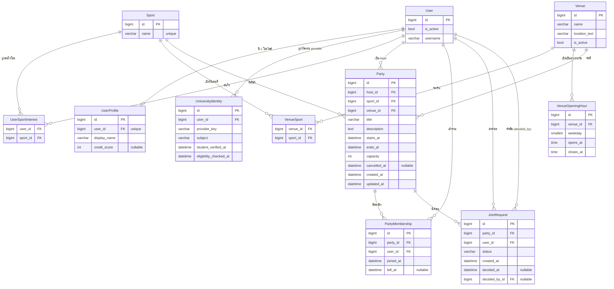
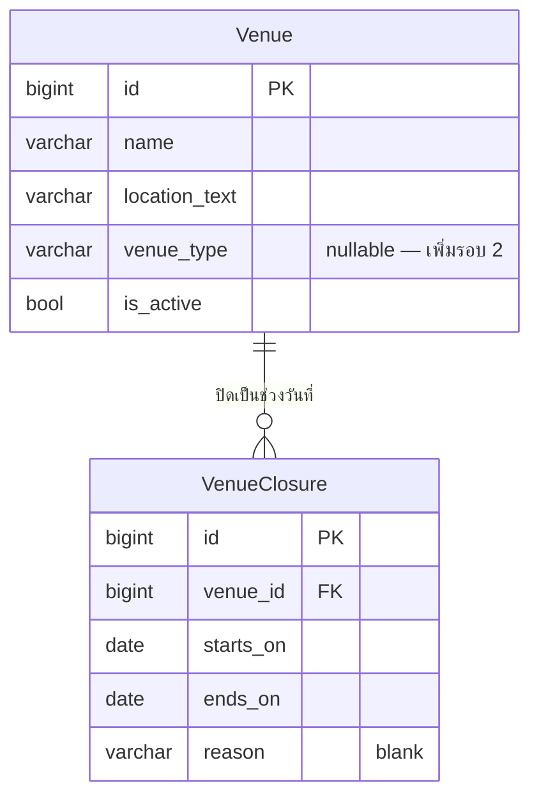
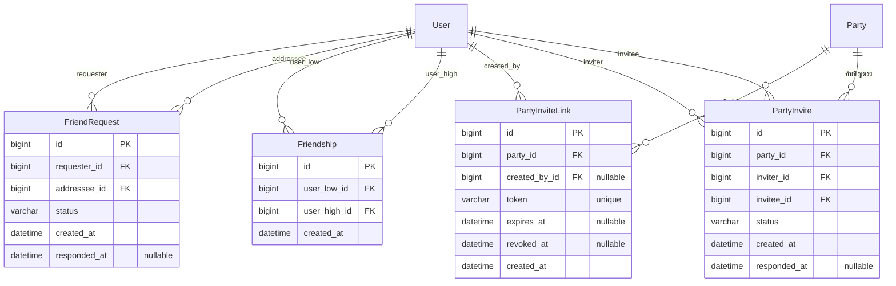
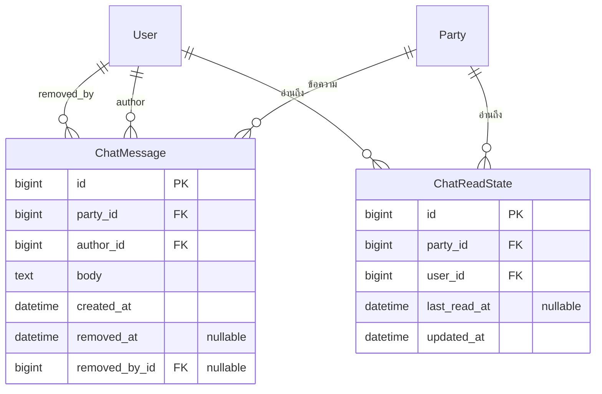
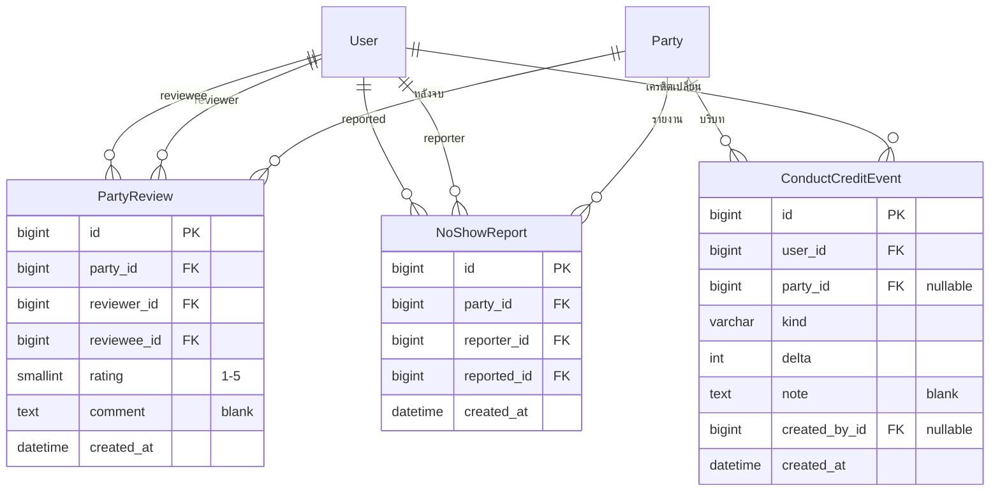
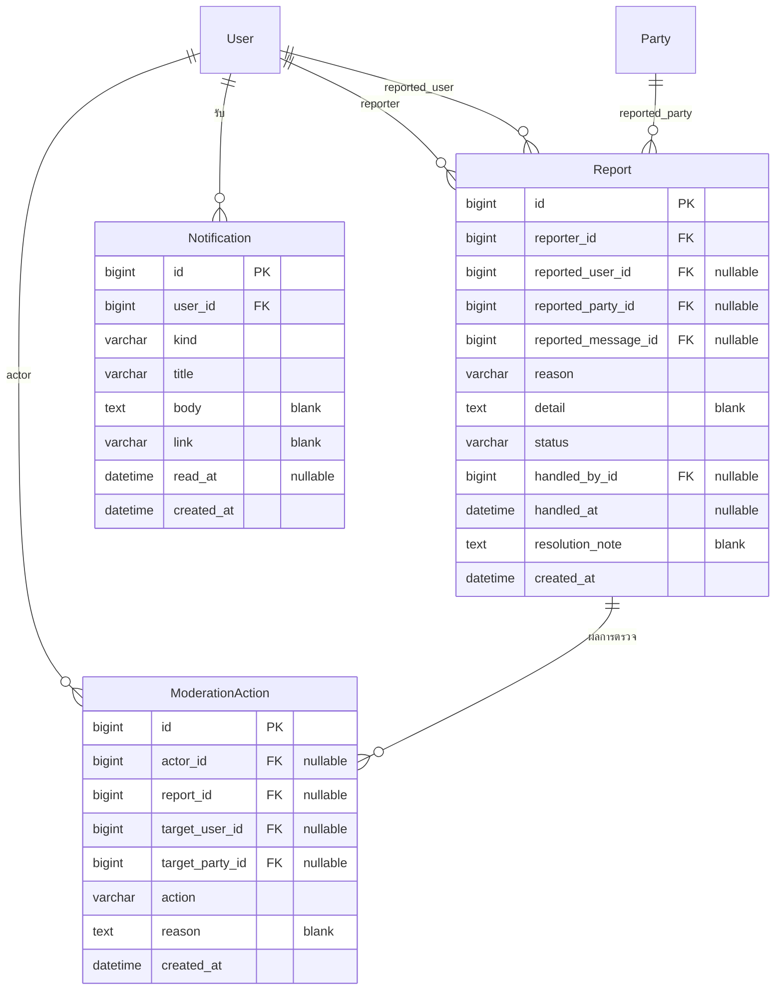

# BASE-02 — Schema Contract (ERD / Data Dictionary / Decision Log)

ผลส่งมอบของ **BASE-02-01** (โกล / กอล์ฟ + เกียร์ประสานงาน) ใช้คู่กับ [Sprint 1 Technical Plan](sprint-1-technical-plan.md) หัวข้อ 2–3 และ [Development guide](development.md)

**สถานะ: Draft รอรีวิว — มี models และ migrations ของ Sprint 1 แล้ว; business logic และ schema tests ยังต้องพัฒนาต่อ**

**อัปเดต 12 ต.ค. 2026:** ขยาย ERD ให้ **ครอบคลุมทั้งระบบ** ตามความเห็นตอนรีวิว (เดิมมีเฉพาะ 11 ตารางของ Sprint 1) — ดู [หัวข้อ 1](#1-ขอบเขต) แผนที่ Story → ตาราง, หัวข้อ 2.1 ERD ภาพรวม และหัวข้อ 2.3–2.7 รายละเอียดตารางรอบถัดไป **การสร้าง migration ยังจำกัดเฉพาะชุด A/B/C ของ Sprint 1 เท่านั้น** ดูหัวข้อ 9.2 และหัวข้อ 11 เมื่อทีมยืนยันแล้ว เอกสารนี้เป็นสัญญาที่ BASE-02-02 (migrations), BASE-02-03 (contract + service) และเจ้าของ US9-B1-01/US3-B/US7-B/US8-B ต้องยึดร่วมกัน

Source of truth ของ schema คือ Django ORM และ migrations ใน `backend/<app>/migrations/` (ดู [database/README.md](../database/README.md)) — ERD นี้เป็นเอกสารอธิบาย ไม่ใช่ DDL ที่จะรันแยก และห้ามสร้าง schema ชุดที่สองด้วย SQL

## 1. ขอบเขต

เอกสารนี้มีสองระดับที่ต้องแยกให้ชัด:

| ระดับ | ครอบคลุมอะไร | สถานะ |
| --- | --- | --- |
| **ERD ทั้งระบบ** (ผลส่งมอบของ BASE-02-01) | ทุกตารางของทุกโดเมนที่ผลิตภัณฑ์นี้วางไว้ใน [README](../README.md) และ US1–US14 ใน [User Stories](user-stories.md) | ออกแบบครบในเอกสารนี้: หัวข้อ 2.1 ภาพรวม, หัวข้อ 2.2 รอบนี้, หัวข้อ 2.3–2.7 ตารางรอบถัดไป, หัวข้อ 3 data dictionary |
| **Migration ที่สร้างจริงใน Sprint 1** | 11 ตารางในชุด A/B/C (ดูหัวข้อ 1.2) | มี migrations แล้วตามรายการในหัวข้อ 8; ขั้นตรวจสอบอยู่ในหัวข้อ 11 |

**ทำไมต้องมีทั้งสองระดับ:** งานออกแบบ (BASE-02-01) ต้องเห็นภาพข้อมูลทั้งระบบ เพื่อไม่ให้ตารางรอบถัดไปชนกับของเดิม (US11–US14, แชท และงานผู้ดูแลอ้าง `User`/`Party`/`PartyMembership` เดิม) แต่ **ห้ามสร้าง migration ของตารางรอบ 2–5 ก่อน Story นั้นเข้า Sprint** และก่อนแก้เอกสารนี้ให้เลื่อนสถานะ (ดู Q-7…Q-13)

### 1.1 แผนที่ Story/ฟีเจอร์ → ตาราง

| โดเมน / Story | ตารางที่ใช้ | รอบที่สร้าง |
| --- | --- | --- |
| US1 login / ยืนยันสิทธิ์นักศึกษา | `User` (BASE-01), `UniversityIdentity` (US1-B-01) | 1 |
| US8 โปรไฟล์, US5 แนะนำผู้ใช้ | `UserProfile`, `Sport`, `UserSportInterest` | 1 |
| US9 สนามและเวลาเปิด | `Venue`, `VenueSport`, `VenueOpeningHour` | 1 |
| สร้าง Party, US3 ขอเข้าร่วม, US4 ถอนตัว, US6 รายชื่อสมาชิก, US7 แก้ไข/ยกเลิก, US10 อนุมัติ | `Party`, `PartyMembership`, `JoinRequest` (ไม่ต้องมีตารางใหม่) | 1 |
| US2 ค้นหา/กรอง (sport, วันเวลา, ประเภทสถานที่) | `Venue.venue_type` (คอลัมน์ใหม่) + `VenueClosure` + index ค้นหา | 2 |
| US13 เชิญผ่านลิงก์ | `PartyInviteLink` (+ `PartyInvite` ถ้าเลือกเชิญตรงหาผู้ใช้) | 2 |
| US11 เพิ่มเพื่อน, US12 ลบเพื่อน | `FriendRequest`, `Friendship` | 3 |
| แชทใน Party (README) | `ChatMessage`, `ChatReadState` | 4 |
| US14 ให้ดาว/รีวิว/No-show | `PartyReview`, `NoShowReport`, `ConductCreditEvent` + `UserProfile.rating_sum/rating_count` | 5 |
| รายงานปัญหาและผู้ดูแล (README) | `Report`, `ModerationAction` (+ `ChatMessage.removed_at/by`) | 5 |
| แจ้งเตือน | `Notification` | **รอ Story ยืนยัน** (Q-10) |

### 1.2 อยู่ในสัญญารอบนี้ (11 ตาราง — รอบ 1)

`User` (มีแล้วจาก BASE-01), `UserProfile`, `UniversityIdentity`, `Sport`, `UserSportInterest`, `Venue`, `VenueSport`, `VenueOpeningHour`, `Party`, `PartyMembership`, `JoinRequest`

ทุก model รอบนี้มี primary key `id` เป็น `BigAutoField` รวมถึงตารางเชื่อม `VenueSport` และ `UserSportInterest` ซึ่งใช้ UniqueConstraint ของคู่ FK เพิ่มเติมเพื่อป้องกันข้อมูลซ้ำ

### 1.3 ตารางรอบถัดไป (ออกแบบแล้ว ยังไม่สร้าง migration)

| รอบ | ตารางที่เพิ่ม | Story/ฟีเจอร์ | รายละเอียด |
| --- | --- | --- | --- |
| 2 | `Venue.venue_type` (คอลัมน์), `VenueClosure` | US2, US9 (วันปิด) | หัวข้อ 2.3, หัวข้อ 3.2 |
| 2 | `PartyInviteLink`, `PartyInvite` | US13 | หัวข้อ 2.4, หัวข้อ 3.5 |
| 3 | `FriendRequest`, `Friendship` | US11/US12 | หัวข้อ 2.4, หัวข้อ 3.4 |
| 4 | `ChatMessage`, `ChatReadState` | แชทใน Party | หัวข้อ 2.5, หัวข้อ 3.6 |
| 5 | `PartyReview`, `NoShowReport`, `ConductCreditEvent`, `UserProfile.rating_sum/rating_count` | US14 (US8 อ่านค่า) | หัวข้อ 2.6, หัวข้อ 3.7 |
| 5 | `Report`, `ModerationAction` | รายงาน/ผู้ดูแล | หัวข้อ 2.7, หัวข้อ 3.8 |
| — | `Notification` | ยังไม่มี Story | หัวข้อ 2.7, หัวข้อ 3.9 — รอ Q-10 |

`PartyInvite` (คำเชิญตรงหาผู้ใช้) เป็นทางเลือก: ขอบเขตแรกของ US13 คือลิงก์เชิญตาม task ฉบับแก้ — ถ้าทีมเลือกทำเฉพาะลิงก์ ให้สร้าง `PartyInviteLink` เท่านั้น

### 1.4 ยังไม่อยู่ในแบบทั้งระบบ (อย่าเผื่อตาราง)

| เรื่อง | เหตุผล |
| --- | --- |
| ตารางจองสนาม / กันชนเวลาสนาม | ไม่มี requirement ว่า Party ต้องจอง/กันสิทธิ์สนาม (D-10) |
| ไฟล์แนบ/รูปในแชท | README ระบุแชทข้อความเท่านั้น |
| พิกัด GPS / แผนที่ | `Venue.location_text` เป็นจุดนัดพบขั้นต่ำ |
| ระบบบล็อกผู้ใช้ (block) | ไม่มี US หรือ AC ใดกล่าวถึง — ใช้รายงาน + ผู้ดูแลแทน |
| ตารางเก็บรหัสผ่าน/โทเคนมหาวิทยาลัย | D-9 — ใช้ session ของ Django |

`UniversityIdentity` อยู่ในลิสต์ตาราง แต่ **เจ้าของคือ US1-B-01** — ถ้าตกลงให้ BASE-02-02 ทำแทน ต้องย้ายเจ้าของและวันส่งใน checklist

## 2. ERD

### 2.1 ภาพรวมทั้งระบบ (ทุกโดเมน)

แผนที่ความสัมพันธ์ระดับโดเมน — ยังไม่แสดงคอลัมน์ เพื่อให้เห็นภาพเดียวว่าทุก Story ใช้ข้อมูลชุดเดียวกันอย่างไร รายละเอียดคอลัมน์อยู่ในหัวข้อ 2.2 (รอบนี้) และหัวข้อ 2.3–2.7 (รอบถัดไป)

```mermaid
erDiagram
    User ||--o| UserProfile : "1 โปรไฟล์"
    User ||--o{ UniversityIdentity : "ผูก provider"
    User ||--o{ UserSportInterest : "สนใจ"
    Sport ||--o{ UserSportInterest : "ถูกสนใจ"
    Sport ||--o{ VenueSport : "เปิดให้เล่น"
    Venue ||--o{ VenueSport : "รองรับกีฬา"
    Venue ||--o{ VenueOpeningHour : "เวลาเปิดรายสัปดาห์"
    Venue ||--o{ VenueClosure : "วันที่ปิดเป็นต้น"
    User ||--o{ Party : "เป็น Host"
    Sport ||--o{ Party : "กีฬา"
    Venue ||--o{ Party : "สถานที่"
    Party ||--o{ PartyMembership : "มีสมาชิก"
    User ||--o{ PartyMembership : "เข้าร่วม"
    Party ||--o{ JoinRequest : "มีคำขอ"
    User ||--o{ JoinRequest : "ส่งคำขอ"
    Party ||--o{ PartyInviteLink : "ลิงก์เชิญ"
    Party ||--o{ PartyInvite : "คำเชิญตรง"
    User ||--o{ PartyInvite : "เชิญ / ถูกเชิญ"
    User ||--o{ FriendRequest : "ส่ง / รับคำขอเพื่อน"
    User ||--o{ Friendship : "เป็นเพื่อน"
    Party ||--o{ ChatMessage : "ข้อความ"
    User ||--o{ ChatMessage : "เขียน"
    Party ||--o{ ChatReadState : "อ่านถึง"
    User ||--o{ ChatReadState : "อ่านถึง"
    Party ||--o{ PartyReview : "รีวิวหลังจบ"
    User ||--o{ PartyReview : "ผู้รีวิว / ผู้ถูกรีวิว"
    Party ||--o{ NoShowReport : "รายงานไม่มาตามนัด"
    User ||--o{ NoShowReport : "ผู้รายงาน / ผู้ถูกรายงาน"
    User ||--o{ ConductCreditEvent : "เครดิตเปลี่ยน"
    Party ||--o{ ConductCreditEvent : "บริบทกิจกรรม"
    User ||--o{ Report : "ส่งรายงาน"
    User ||--o{ Report : "ผู้ถูกรายงาน"
    Party ||--o{ Report : "Party ที่ถูกรายงาน"
    User ||--o{ ModerationAction : "ผู้ดูแลจัดการ"
    Report ||--o{ ModerationAction : "ผลการตรวจ"
    User ||--o{ Notification : "รับ"
```



**อ่านคู่กับหัวข้อ 1.1:** ทุกตารางรอบ 2–5 อ้าง `User` / `Party` / `PartyMembership` เดิม ไม่มีตารางสำรองของ User หรือ Party

### 2.2 รอบนี้ (Sprint 1) — 11 ตารางที่มี migration



### 2.3 รอบถัดไป — US2 ค้นหา และวันปิดสนาม

เพิ่มคอลัมน์บน `Venue` และตารางใหม่ 1 ตาราง ไม่แตะตารางเดิมของรอบ 1



- `venue_type` เป็น TextChoices (Indoor/Outdoor) และ **nullable** จนกว่าทีมจะยืนยันนิยาม "ประเภทสถานที่" ของ US2 (Technical Plan หัวข้อ 1 ยังไม่เลือก US2 เข้า Sprint)
- Rule US2: ตัวกรองคือ `sport` + ช่วงวันเวลา (`starts_at`/`ends_at` ของ Party) + `venue_type` คนละแกนกัน ไม่เก็บ `venue_type` ซ้ำบน Party
- Rule วันปิด: `validate_party_schedule` ต้องปฏิเสธวันนัดที่ทับ `VenueClosure` ของสนามนั้นด้วย — ขยาย D-8 เมื่อ Story นี้เข้า Sprint
- index ค้นหาเสนอเพิ่มในรอบเดียวกัน: `Party (venue_id, starts_at)` และ `Party (starts_at)` เพราะตัวกรอง US2 ใช้ sport + ช่วงวันเวลา + สนาม/ประเภทสนามร่วมกัน (index `(sport_id, starts_at)` มีแล้วในรอบ 1)

### 2.4 รอบถัดไป — เพื่อนและคำเชิญ (US11/US12/US13)



- `Friendship` เก็บ **หนึ่งแถวต่อคู่** โดยบังคับ `user_low_id < user_high_id` ผ่าน CheckConstraint แล้ว query สองทางด้วย `Q(user_low=me) | Q(user_high=me)` — ทั้งสองฝ่ายเห็นความสัมพันธ์เดียวกันและไม่มีแถวคู่ที่เขียนไม่ตรงกัน
- US12 ลบเพื่อน = ลบแถวนั้นได้จริง เป็นข้อยกเว้นของ D-7 เพราะไม่มีตารางใดอ้าง Friendship (ถ้าทีมต้องการเก็บประวัติ ให้เพิ่ม `removed_at` และ partial unique แทน — Q-8)
- `FriendRequest` ห้ามส่งซ้ำและห้ามส่งย้อนทางกับคำขอ Pending ที่มีอยู่ — `unique (requester_id, addressee_id)` จับซ้ำทางเดียว ส่วนย้อนทางเป็น service rule ใน transaction เดียว
- เฉพาะผู้รับ (`addressee`) ตอบรับ/ปฏิเสธได้ และ `requester_id <> addressee_id` เป็น CheckConstraint
- `PartyInviteLink.token` สุ่มฝั่งเซิร์ฟเวอร์ (ไม่ใช่ `party_id`) ให้ยาวพอเดาไม่ได้; ลิงก์ใช้ได้เมื่อ `revoked_at IS NULL` และ (`expires_at IS NULL` หรือยังไม่หมดอายุ) และ Party ยังรับคำขอ
- **เปิดลิงก์ไม่เพิ่มสมาชิกโดยตรง** — ไปหน้า Party แล้วส่ง `JoinRequest` เป็น Pending ผ่าน US3 + รออนุมัติ US10 ตามกติกาเดิม
- `PartyInvite` (เชิญตรงหาผู้ใช้) เป็นทางเลือกของ US13; ถ้าทำ ต้องมี `unique (party_id, invitee_id)`, `inviter_id <> invitee_id` และการตอบรับก็สร้าง `JoinRequest` ไม่ใช่ membership

### 2.5 รอบถัดไป — แชทใน Party



- อ่าน/เขียนได้เฉพาะสมาชิกที่ `left_at IS NULL` — ถอนตัวแล้วต้องได้ 403 และหลุดจาก Channels group ทันที (DoD ข้อแชท)
- Party จบ/ถูกยกเลิกแล้ว: อ่านประวัติได้ (ถ้าเคยเป็นสมาชิก) แต่ส่งข้อความใหม่ไม่ได้
- ไม่มีตารางไฟล์แนบ; `body` จำกัดความยาวใน validation
- ลบข้อความ = soft delete (`removed_at`, `removed_by_id`) เพื่อให้ผู้ดูแลตรวจสอบย้อนหลังได้ ไม่ใช้ hard delete
- ยังไม่เปิด Redis/Channels จน Story แชทเข้า Sprint — ตารางออกแบบไว้ล่วงหน้าเท่านั้น (D-11)

### 2.6 รอบถัดไป — รีวิว ดาว และความประพฤติ (US14)



- `PartyReview`: เฉพาะสมาชิกของ Party นั้น (มี `PartyMembership` ของคู่ (party, reviewer) และ (party, reviewee)) และเฉพาะหลัง `Completed`; `unique (party_id, reviewer_id, reviewee_id)`; CheckConstraint `rating BETWEEN 1 AND 5` และ `reviewer_id <> reviewee_id`
- `NoShowReport`: reporter ต้องเป็นสมาชิก Party เดียวกัน หลังจบเท่านั้น; `unique (party_id, reporter_id, reported_id)`; ห้ามรายงานตัวเอง
- เกณฑ์หักเครดิต (เช่น ผู้รายงานไม่ซ้ำมากกว่าครึ่งของสมาชิก active) ตัดสินครั้งเดียวแล้วสร้าง `ConductCreditEvent(kind='NO_SHOW_DEDUCTION')` หนึ่งใบ — `unique (party_id, user_id, kind)` บังคับ "หักได้ครั้งเดียวต่อคนต่อกิจกรรม" (แถวที่ `party_id IS NULL` สำหรับการปรับโดยผู้ดูแลไม่ถูกจำกัดด้วย unique นี้)
- ดาวเฉลี่ยและเครดิตคนละค่า: `rating_sum`/`rating_count` เป็น aggregate ของ `PartyReview` (cache บน `UserProfile` อัปเดตด้วย `F()` ใน transaction เดียวกับตอนเขียนรีวิว) ส่วน `credit_score` เป็นผลของ ledger `ConductCreditEvent`
- ยังไม่ยืนยันค่าเริ่มต้น/สูตรเครดิต → คง `credit_score` เป็น `null` และแสดง "ยังไม่มีข้อมูล" ได้ (D-6); ledger เก็บไว้เป็นประวัติก่อนตกลงสูตร
- ไม่มีรีวิว → `rating_count = 0` → API ส่ง `null` ไม่ใช่ 0

### 2.7 รอบถัดไป — รายงาน ผู้ดูแล และแจ้งเตือน



- `Report` อ้างเป้าด้วย FK แยก (`reported_user_id` / `reported_party_id` / `reported_message_id`) พร้อม CheckConstraint ว่ามีเป้าไม่ `NULL` **อย่างเดียว** — เลือกวิธีนี้แทน Django generic relation เพื่อไม่เพิ่ม dependency และคุมสิทธิ์ได้ตรงไปตรงมา
- CheckConstraint: สถานะ `Open`/`InReview` ต้องมี `handled_at IS NULL`; หนึ่งผู้ใช้เปิดรายงานซ้ำต่อเป้าเดิมคุมด้วย service rule (พร้อม index `(status, created_at)`)
- `ModerationAction` เป็น log ห้ามลบ — ระงับผู้ใช้ = `User.is_active=False`; ปิด Party = `Party.cancelled_at`; ลบข้อความ = `ChatMessage.removed_at`
- บทบาทผู้ดูแลยังใช้ `User.is_staff` + สิทธิ์ Django ที่ BASE-01 มีอยู่ — ยังไม่มีตาราง role ใหม่ (Q-12)
- `Notification` ยังไม่มี Story รองรับ — ออกแบบไว้เพื่อไม่ให้ชนกับตารางเดิม ถ้าทีมไม่ทำ ให้ตัดตารางนี้ออกจากหัวข้อ 2.1 ก่อนรีวิวรอบสุดท้าย (Q-10)

## 3. Data Dictionary

ประเภทเป็น Django field; ทุก FK ชี้ `settings.AUTH_USER_MODEL` ไม่ hardcode `accounts.User` ([development.md](development.md))

### 3.1 app `accounts` (มีอยู่แล้วจาก BASE-01)

| ตาราง | ฟิลด์ | ประเภท | Null | Constraint / Index |
| --- | --- | --- | --- | --- |
| **User** | `id`, `username`, `is_active`, `date_joined`, ฯลฯ | Django `AbstractUser` ตามที่มีอยู่ | — | ตัดสิน user model แล้ว; **ไม่เพิ่มตาราง/คอลัมน์เก็บรหัสผ่านมหาวิทยาลัย** |
| **UserProfile** | `user_id` | OneToOne → AUTH_USER_MODEL | ไม่ | `unique`; `on_delete=CASCADE` |
| | `display_name` | CharField(100) | ไม่ | `blank=False` + CheckConstraint กันค่าว่าง/ช่องว่างล้วน |
| | `credit_score` | IntegerField | **ใช่** | ถ้ายังไม่กำหนดเครดิตตั้งต้นให้เป็น `null` แล้วแสดง "ยังไม่มีข้อมูล" — ไม่สมมติสูตรหรือค่าเริ่มต้น |
| | `rating_sum`, `rating_count` | IntegerField (default 0) | ไม่ | **รอบ 5 (US14):** cache ของ `PartyReview`; ดาวเฉลี่ย = `rating_sum / rating_count` และส่ง `null` เมื่อ `rating_count = 0` — ไม่ใช่ฟิลด์ที่ client แก้ได้ |
| **UniversityIdentity** *(เจ้าของ US1-B-01)* | `user_id` | FK → AUTH_USER_MODEL | ไม่ | index; `on_delete=CASCADE`; FK ไม่ใช่ OneToOne เพราะผูกได้หลาย provider |
| | `provider_key` | CharField(150) | ไม่ | มาจากค่าตั้งฝั่งเซิร์ฟเวอร์ ไม่รับจาก request |
| | `subject` | CharField(255) | ไม่ | มาจากผลตรวจ provider; ห้ามใช้ชื่อ/email ผูกบัญชี |
| | `student_verified_at`, `eligibility_checked_at` | DateTimeField | ใช่ | เวลาเซิร์ฟเวอร์; ไม่เก็บ password/token/assertion |

| **UserSportInterest** | `user_id`, `sport_id` | FK → AUTH_USER_MODEL / venues.Sport | ไม่ | unique `(user_id, sport_id)`; อยู่ใน `accounts` |

### 3.2 app `venues` (ประสานกับ US9-B1-01)

| ตาราง | ฟิลด์ | ประเภท | Null | Constraint / Index |
| --- | --- | --- | --- | --- |
| **Sport** | `name` | CharField(80) | ไม่ | `unique`; model คือ `venues.Sport` |
| **Venue** | `name` | CharField(150) | ไม่ | — |
| | `location_text` | CharField(255) | ไม่ | จุดนัดพบขั้นต่ำ; ยังไม่ทำพิกัด/GPS ใน Sprint นี้ |
| | `is_active` | BooleanField (default True) | ไม่ | สนาม `is_active=False` ห้ามใช้สร้าง/แก้ Party (ตรวจที่ service) |
| | `venue_type` | CharField(TextChoices Indoor/Outdoor) | **ใช่** | **รอบ 2 (US2):** เพิ่มเมื่อทีมยืนยันนิยาม "ประเภทสถานที่"; ยังไม่ใส่ index จนรู้รูปแบบ query จริง |
| **VenueSport** | `venue_id`, `sport_id` | FK | ไม่ | `unique_together (venue_id, sport_id)`; **index `sport_id`** สำหรับค้นสนามตามกีฬา; composite PK หรือ id + unique ก็ได้ แต่ต้องมี unique คู่นี้ |
| **VenueOpeningHour** | `venue_id` | FK → Venue | ไม่ | `on_delete=CASCADE` |
| | `weekday` | SmallIntegerField | ไม่ | 0–6 = จันทร์–อาทิตย์; CheckConstraint `0 <= weekday <= 6` |
| | `opens_at`, `closes_at` | TimeField | ไม่ | CheckConstraint `opens_at < closes_at` (ยังไม่รองรับข้ามเที่ยงคืน) |
| | — | — | — | `unique (venue_id, weekday, opens_at)`; **validator กันช่วงซ้อนในวันเดียวกัน** (ทำได้แค่ระดับแอป ไม่ใช่ DB constraint) |
| **VenueClosure** *(รอบ 2)* | `venue_id` | FK → Venue | ไม่ | `on_delete=CASCADE`; index `(venue_id, starts_on)` |
| | `starts_on`, `ends_on` | DateField | ไม่ | CheckConstraint `starts_on <= ends_on`; หนึ่งวันใช้ `starts_on = ends_on` |
| | `reason` | CharField(150) | ไม่ (ใช้ `blank=True`) | เหตุผลที่แสดงต่อผู้ใช้ เช่น วันหยุดมหาวิทยาลัย / ปรับปรุงสนาม |
| | — | — | — | `unique (venue_id, starts_on)`; กันช่วงวันปิดซ้อนเป็น service validator (เหมือน OpeningHour) |

### 3.3 app `parties` (ใหม่)

| ตาราง | ฟิลด์ | ประเภท | Null | Constraint / Index |
| --- | --- | --- | --- | --- |
| **Party** | `host_id` | FK → AUTH_USER_MODEL | ไม่ | `on_delete=PROTECT`; index |
| | `sport_id` | FK → Sport | ไม่ | `on_delete=PROTECT` |
| | `venue_id` | FK → Venue | ไม่ | `on_delete=PROTECT`; **ต้องมี migration Venue มาก่อน (ดูหัวข้อ 8)** |
| | `title` | CharField(150) | ไม่ | — |
| | `description` | TextField | ไม่ (ใช้ `blank=True`) | จำกัด ≤ 2,000 ตัวอักษรใน validation |
| | `starts_at`, `ends_at` | DateTimeField (aware, เก็บ UTC) | ไม่ | CheckConstraint `starts_at < ends_at`; index `(sport_id, starts_at)` |
| | `capacity` | PositiveIntegerField | ไม่ | CheckConstraint `capacity >= 1`; **นับรวม Host** |
| | `cancelled_at` | DateTimeField | **ใช่** | ไม่เก็บ "Full" ลง DB (คำนวณอย่างเดียว) |
| | `created_at`, `updated_at` | DateTimeField | ไม่ | `auto_now_add` / `auto_now` |
| **PartyMembership** | `party_id` | FK → Party | ไม่ | `on_delete=CASCADE`; index `(party_id, left_at)` ช่วยนับ active |
| | `user_id` | FK → AUTH_USER_MODEL | ไม่ | `on_delete=PROTECT` |
| | `joined_at` | DateTimeField | ไม่ | — |
| | `left_at` | DateTimeField | **ใช่** | active membership = `left_at IS NULL` |
| | — | — | — | `unique (party_id, user_id)` — **หนึ่งแถวต่อคนต่อ Party ตลอดไป**; ถอนแล้วกลับเข้าใช้อัปเดต `left_at=None` แถวเดิม ไม่สร้างแถวใหม่ |
| | `role` | **ไม่เก็บเป็นคอลัมน์** | — | คำนวณจาก `Party.host_id == user_id` |
| **JoinRequest** | `party_id` | FK → Party | ไม่ | `on_delete=CASCADE`; index `(party_id, status, created_at)` |
| | `user_id` | FK → AUTH_USER_MODEL | ไม่ | `on_delete=PROTECT` |
| | `status` | CharField(TextChoices Pending/Approved/Rejected) | ไม่ | default `Pending` |
| | `created_at` | DateTimeField | ไม่ | — |
| | `decided_at` | DateTimeField | **ใช่** | เตรียมสำหรับ US10 |
| | `decided_by_id` | FK → AUTH_USER_MODEL | **ใช่** | `on_delete=SET_NULL`; เตรียมสำหรับ US10 |
| | — | — | — | `unique (party_id, user_id)`: **Pending เดิม → `409 REQUEST_EXISTS`** (ไม่สร้างแถวซ้ำ) |
| | — | — | — | CheckConstraint: `status = 'Pending'` ⇒ `decided_at IS NULL AND decided_by_id IS NULL` |

### 3.4 app `social` (รอบ 3) — เพื่อน (US11/US12)

| ตาราง | ฟิลด์ | ประเภท | Null | Constraint / Index |
| --- | --- | --- | --- | --- |
| **FriendRequest** | `requester_id` | FK → AUTH_USER_MODEL | ไม่ | `on_delete=CASCADE`; CheckConstraint `requester_id <> addressee_id` |
| | `addressee_id` | FK → AUTH_USER_MODEL | ไม่ | `on_delete=CASCADE`; index `(addressee_id, status, created_at)` |
| | `status` | CharField(TextChoices Pending/Accepted/Rejected/Cancelled) | ไม่ | default `Pending` |
| | `created_at` | DateTimeField | ไม่ | — |
| | `responded_at` | DateTimeField | **ใช่** | CheckConstraint: `status = 'Pending'` ⇒ `responded_at IS NULL` |
| | — | — | — | `unique (requester_id, addressee_id)`; ทิศย้อนทางที่ยัง Pending คุมด้วย service rule |
| **Friendship** | `user_low_id`, `user_high_id` | FK → AUTH_USER_MODEL | ไม่ | `on_delete=CASCADE`; CheckConstraint `user_low_id < user_high_id` |
| | `created_at` | DateTimeField | ไม่ | — |
| | — | — | — | `unique (user_low_id, user_high_id)` + index `(user_high_id)` สำหรับ query ย้อนทาง |

**หมายเหตุ:** ถ้าทีมเลือกเก็บประวัติการลบเพื่อน ให้เพิ่ม `removed_at` และ partial unique `(user_low_id, user_high_id) WHERE removed_at IS NULL` — ตัดสินใน Q-8

### 3.5 app `social` (รอบ 2) — คำเชิญ (US13)

| ตาราง | ฟิลด์ | ประเภท | Null | Constraint / Index |
| --- | --- | --- | --- | --- |
| **PartyInviteLink** | `party_id` | FK → Party | ไม่ | `on_delete=CASCADE`; index `(party_id, revoked_at)` |
| | `created_by_id` | FK → AUTH_USER_MODEL | **ใช่** | `on_delete=SET_NULL`; เก็บไว้เพื่อ audit ว่าใครสร้างลิงก์ |
| | `token` | CharField(64) | ไม่ | `unique`; สุ่มฝั่งเซิร์ฟเวอร์; ห้ามใช้ `party_id` หรือข้อความที่เดาได้ |
| | `expires_at` | DateTimeField | **ใช่** | `null` = ไม่หนดอายุตามเวลา (ยังปิดด้วย `revoked_at` ได้) |
| | `revoked_at` | DateTimeField | **ใช่** | ลิงก์ที่ถูก revoke ใช้ไม่ได้ทันที |
| | `created_at` | DateTimeField | ไม่ | — |
| **PartyInvite** *(ทางเลือก)* | `party_id` | FK → Party | ไม่ | `on_delete=CASCADE` |
| | `inviter_id`, `invitee_id` | FK → AUTH_USER_MODEL | ไม่ | `on_delete=CASCADE`; CheckConstraint `inviter_id <> invitee_id`; index `(invitee_id, status, created_at)` |
| | `status` | CharField(TextChoices Pending/Accepted/Declined/Revoked) | ไม่ | default `Pending` |
| | `created_at`, `responded_at` | DateTimeField | `responded_at` **ใช่** | CheckConstraint: `Pending` ⇒ `responded_at IS NULL` |
| | — | — | — | `unique (party_id, invitee_id)` |

### 3.6 app `chat` (รอบ 4) — แชทใน Party

| ตาราง | ฟิลด์ | ประเภท | Null | Constraint / Index |
| --- | --- | --- | --- | --- |
| **ChatMessage** | `party_id` | FK → Party | ไม่ | `on_delete=CASCADE`; index `(party_id, created_at)` |
| | `author_id` | FK → AUTH_USER_MODEL | ไม่ | `on_delete=PROTECT`; ลบ user ที่มีข้อความไม่ได้ |
| | `body` | TextField | ไม่ | validation ≤ 2,000 ตัวอักษรและไม่รับช่องว่างล้วน |
| | `created_at` | DateTimeField | ไม่ | เก็บ UTC; ใช้เรียงลำดับ |
| | `removed_at` | DateTimeField | **ใช่** | soft delete ไม่ลบจริง |
| | `removed_by_id` | FK → AUTH_USER_MODEL | **ใช่** | `on_delete=SET_NULL`; ใครสั่งลบ (เจ้าของ/Host/ผู้ดูแล) |
| **ChatReadState** | `party_id`, `user_id` | FK | ไม่ | `on_delete=CASCADE`; `unique (party_id, user_id)` |
| | `last_read_at` | DateTimeField | **ใช่** | ใช้คำนวณ unread; `null` = ยังไม่เคยเปิดอ่าน |
| | `updated_at` | DateTimeField | ไม่ | `auto_now` |

### 3.7 app `conduct` (รอบ 5) — รีวิว/ดาว/ความประพฤติ (US14)

| ตาราง | ฟิลด์ | ประเภท | Null | Constraint / Index |
| --- | --- | --- | --- | --- |
| **PartyReview** | `party_id` | FK → Party | ไม่ | `on_delete=CASCADE`; index `(reviewee_id, created_at)` |
| | `reviewer_id`, `reviewee_id` | FK → AUTH_USER_MODEL | ไม่ | `on_delete=PROTECT` (ประวัติความประพฤติ); CheckConstraint `reviewer_id <> reviewee_id` |
| | `rating` | SmallIntegerField | ไม่ | CheckConstraint `1 <= rating <= 5` |
| | `comment` | TextField | ไม่ (ใช้ `blank=True`) | จำกัดความยาวใน validation |
| | `created_at` | DateTimeField | ไม่ | — |
| | — | — | — | `unique (party_id, reviewer_id, reviewee_id)` |
| **NoShowReport** | `party_id` | FK → Party | ไม่ | `on_delete=CASCADE`; index `(party_id, reported_id)` |
| | `reporter_id`, `reported_id` | FK → AUTH_USER_MODEL | ไม่ | `on_delete=PROTECT` (ประวัติความประพฤติ); CheckConstraint `reporter_id <> reported_id` |
| | `created_at` | DateTimeField | ไม่ | — |
| | — | — | — | `unique (party_id, reporter_id, reported_id)` |
| **ConductCreditEvent** | `user_id` | FK → AUTH_USER_MODEL | ไม่ | `on_delete=PROTECT`; index `(user_id, created_at)` |
| | `party_id` | FK → Party | **ใช่** | `on_delete=SET_NULL`; การปรับโดยผู้ดูแลไม่ต้องมี Party |
| | `kind` | CharField(TextChoices NoShowDeduction/AdminAdjustment/AppealReversal) | ไม่ | — |
| | `delta` | IntegerField | ไม่ | CheckConstraint `delta <> 0`; ค่าลบ = หักเครดิต |
| | `note` | TextField | ไม่ (ใช้ `blank=True`) | — |
| | `created_by_id` | FK → AUTH_USER_MODEL | **ใช่** | `on_delete=SET_NULL`; `null` = ระบบสร้างอัตโนมัติ |
| | `created_at` | DateTimeField | ไม่ | — |
| | — | — | — | `unique (party_id, user_id, kind)` — หักได้ครั้งเดียวต่อคนต่อกิจกรรม (แถว `party_id IS NULL` ไม่ถูกจำกัด) |

### 3.8 app `moderation` (รอบ 5) — รายงานและผู้ดูแล

| ตาราง | ฟิลด์ | ประเภท | Null | Constraint / Index |
| --- | --- | --- | --- | --- |
| **Report** | `reporter_id` | FK → AUTH_USER_MODEL | ไม่ | `on_delete=CASCADE`; index `(status, created_at)` |
| | `reported_user_id` | FK → AUTH_USER_MODEL | **ใช่** | `on_delete=CASCADE` |
| | `reported_party_id` | FK → Party | **ใช่** | `on_delete=CASCADE` |
| | `reported_message_id` | FK → ChatMessage | **ใช่** | `on_delete=SET_NULL`; อ้างได้หลังเปิดแชทเท่านั้น |
| | — | — | — | CheckConstraint: จากสามฟิลด์เป้าหมาย มีค่าที่ไม่ใช่ NULL **เพียงหนึ่ง** |
| | `reason` | CharField(TextChoices Harassment/NoShow/FakeProfile/InappropriateContent/Spam/Other) | ไม่ | — |
| | `detail` | TextField | ไม่ (ใช้ `blank=True`) | — |
| | `status` | CharField(TextChoices Open/InReview/Resolved/Dismissed) | ไม่ | default `Open` |
| | `handled_by_id` | FK → AUTH_USER_MODEL | **ใช่** | `on_delete=SET_NULL` |
| | `handled_at` | DateTimeField | **ใช่** | CheckConstraint: `status IN ('Open','InReview')` ⇒ `handled_at IS NULL` |
| | `resolution_note` | TextField | ไม่ (ใช้ `blank=True`) | — |
| | `created_at` | DateTimeField | ไม่ | — |
| **ModerationAction** | `actor_id` | FK → AUTH_USER_MODEL | **ใช่** | `on_delete=SET_NULL`; `null` = ระบบอัตโนมัติ |
| | `report_id` | FK → Report | **ใช่** | `on_delete=SET_NULL`; เก็บ Report ไว้ห้ามลบ |
| | `target_user_id` | FK → AUTH_USER_MODEL | **ใช่** | `on_delete=SET_NULL` |
| | `target_party_id` | FK → Party | **ใช่** | `on_delete=SET_NULL` |
| | — | — | — | CheckConstraint: มีเป้าหมายอย่างน้อยหนึ่ง (`target_user_id` หรือ `target_party_id`) |
| | `action` | CharField(TextChoices WarnUser/SuspendUser/ReactivateUser/DeactivateParty/RemoveMessage/NoAction) | ไม่ | — |
| | `reason` | TextField | ไม่ (ใช้ `blank=True`) | — |
| | `created_at` | DateTimeField | ไม่ | log ห้ามลบ |

### 3.9 app `notifications` (ยังไม่มี Story) — แจ้งเตือน

| ตาราง | ฟิลด์ | ประเภท | Null | Constraint / Index |
| --- | --- | --- | --- | --- |
| **Notification** | `user_id` | FK → AUTH_USER_MODEL | ไม่ | `on_delete=CASCADE`; index `(user_id, read_at, created_at)` |
| | `kind` | CharField(80) | ไม่ | เช่น JoinRequestDecided / PartyCancelled / NewMessage / FriendRequest |
| | `title` | CharField(150) | ไม่ | — |
| | `body` | TextField | ไม่ (ใช้ `blank=True`) | — |
| | `link` | CharField(255) | ไม่ (ใช้ `blank=True`) | path ภายในแอปเท่านั้น ห้ามรับ URL ภายนอก |
| | `read_at` | DateTimeField | **ใช่** | `null` = ยังไม่อ่าน |
| | `created_at` | DateTimeField | ไม่ | — |

**เจ้าของแอป:** ชื่อแอปของรอบ 2–5 (`social`, `chat`, `conduct`, `moderation`, `notifications`) เป็นข้อเสนอเพื่อแยกเจ้าของ migration และไม่ให้ไฟล์ของหลายคนชนกัน — ถ้าทีมต้องการลดจำนวนแอป ให้ยัดเข้า `parties`/`accounts` ที่มีอยู่ แต่ต้องระบุให้ชัดใน Q-13 ก่อนเขียน migration

## 4. กฎที่ constraint เดี่ยวทำไม่ได้ — service ต้องรักษา

### 4.1 กฎของตารางรอบนี้ (ข้อ 1–6)

1. Host ต้องมี active membership 1 แถวใน Party ของตนเอง (สร้างพร้อม Party ใน transaction เดียว)
2. จำนวน active membership ≤ `capacity` — ตรวจภายใน transaction ที่ล็อก Party แถวนั้น
3. `VenueSport` ต้องมีคู่ sport/venue ก่อนสร้าง/แก้ Party
4. ช่วงนัดต้องอยู่ในช่วงเปิดหนึ่งช่วงของวันเดียวกัน ตาม `VenueOpeningHour` และ timezone `Asia/Bangkok`
5. ห้ามลบ User/Sport/Venue/Party ที่ถูกอ้างอิง — ใช้ `is_active`/`cancelled_at` แทน; ไม่เปิด delete endpoint โดยไม่จำเป็น
6. ยกเลิก Party แล้วห้ามแก้; `PATCH`/`cancel` ใช้ Party lock ลำดับเดียวกับ service ส่งคำขอ/อนุมัติ

### 4.2 กฎของตารางรอบถัดไป (สัญญาที่ service ต้องรักษาเมื่อ Story เข้า Sprint)

7. `Friendship`/`FriendRequest` — ห้ามส่งคำขอถึงตัวเอง ห้ามส่งซ้ำคู่เดิม และห้ามมีสองทิศเป็น Pending พร้อมกัน; เฉพาะผู้รับตอบ; ลบเพื่อนต้องเป็นคู่ในความสัมพันธ์นั้น
8. `PartyInviteLink` — ตรวจ `revoked_at`/`expires_at` ทุกครั้งที่เปิดลิงก์ และต้องเป็นสมาชิกปัจจุบันของ Party จึงสร้างลิงก์ได้
9. `PartyInvite` (ถ้าทำ) — ผู้เชิญต้องเป็น Host หรือสมาชิก active; ตอบรับแล้วต้องสร้าง/อัปเดต `JoinRequest` ไม่ใช่ membership
10. `ChatMessage` — อ่าน/เขียนเฉพาะสมาชิกที่ `left_at IS NULL`; Party จบ/ยกเลิก → อ่านได้ ส่งไม่ได้; ข้อความถูกลบเป็น soft delete
11. `PartyReview` — เขียนได้เมื่อ Party `Completed` และทั้งคู่อยู่ใน `PartyMembership` ของ Party นั้น; ห้ามรีวิวตัวเอง/ซ้ำ; อัปเดต `rating_sum`/`rating_count` ใน transaction เดียวกับ insert
12. `NoShowReport` — เฉพาะสมาชิกของ Party เดียวกัน หลังจบ และ אחדต่อ (party, reporter, reported); สร้าง `ConductCreditEvent` เมื่อจำนวนผู้รายงานไม่ซ้ำถึงเกณฑ์ที่ทีมตกลงเท่านั้น
13. `ConductCreditEvent` — append-only; แก้ยอดด้วย event ใหม่ (`AdminAdjustment`/`AppealReversal`) ไม่ใช่ update แถวเดิม; `credit_score` ที่แสดง = ผลรวม ledger (หรือ `null` ถ้าทีมยังไม่รับสูตร — D-6)
14. `Report` — ผู้ใช้เปิดรายงานซ้ำต่อเป้าเดิมไม่ได้จนกว่ารายการเดิมจะปิด; เปลี่ยนสถานะได้แค่ผู้ดูแล; `handled_by_id` ต้องเป็นผู้ใช้ที่ `is_staff`
15. `ModerationAction` — ห้ามลบ; การระงับผู้ใช้/ปิด Party ต้องเขียน action คู่กับ `is_active`/`cancelled_at` เสมอ เพื่อให้ย้อนรอยได้ว่าใครสั่ง
16. `Notification` — ลิงก์เป็น path ภายในแอปเท่านั้น และอ่านได้เฉพาะเจ้าของ (`user_id = request.user`) — ถ้าตัดตารางนี้ออก ให้ตัดข้อนี้ด้วย

## 5. สถานะ Party (คำนวณ ไม่เก็บ)

ลำดับตัดสิน (ตัวแรกที่จริงชนะ):

| ลำดับ | สถานะ | เงื่อนไข |
| --- | --- | --- |
| 1 | `Cancelled` | `cancelled_at IS NOT NULL` |
| 2 | `Completed` | `now >= ends_at` |
| 3 | `InProgress` | `starts_at <= now < ends_at` |
| 4 | `Full` | active members ≥ `capacity` |
| 5 | `Open` | ที่เหลือ |

`get_party_state(party, now)` เป็น service กลางของ BASE-02-03 และเป็นแหล่งเดียวที่ API-02/06/07/08/09 อ่านสถานะ

## 6. Error envelope และ HTTP

สำเร็จ: `{"data": ...}`; รายการ: `{"data": [], "page": 1, "page_size": 20, "total": 0}` (`page_size` สูงสุด 100)

```json
{"error": {"code": "VENUE_CLOSED", "message": "...", "fields": {"starts_at": "..."}}}
```

| HTTP | code ที่ใช้ในสคีมานี้ |
| --- | --- |
| 400 | `INVALID_INPUT`, `INVALID_TIME_RANGE`, `VENUE_CLOSED` |
| 401 | `AUTH_REQUIRED` |
| 403 | `FORBIDDEN`, `ACCOUNT_INACTIVE`, `CSRF_FAILED` |
| 404 | `NOT_FOUND` (รวม request ที่ไม่อยู่ใน Party ตาม URL) |
| 409 | `PARTY_FULL`, `PARTY_STARTED`, `PARTY_CANCELLED`, `ALREADY_MEMBER`, `REQUEST_EXISTS`, `REQUEST_DECIDED`, `CAPACITY_TOO_SMALL` |

error envelope เป็น contract ที่ต้อง implement และทดสอบเอง — ไม่ถือว่า Django ส่งรูปแบบนี้ให้อัตโนมัติ

## 7. FK delete policy (ให้สอดคล้องกันทุก migration)

| FK | on_delete | เหตุผล |
| --- | --- | --- |
| `UserProfile.user`, `UniversityIdentity.user`, `UserSportInterest.user/sport`* | `CASCADE` (user) | แถวส่วนตัวของ user ไม่มีความหมายถ้าไม่มี user; และเราไม่ลบ User อยู่แล้ว |
| `VenueSport.venue`, `VenueOpeningHour.venue` | `CASCADE` | ข้อมูลการตั้งค่าของสนาม ตามสนามไป |
| `Party.host_id`, `Party.sport_id`, `Party.venue_id` | `PROTECT` | Party เป็นข้อมูลที่คนอื่นอ้างอิงอยู่ — ลบไม่ได้จนจัดการก่อน |
| `PartyMembership.party_id` | `CASCADE` | ถ้าลบ Party (ซึ่งปกติไม่ทำ) membership ตามไปด้วย |
| `PartyMembership.user_id`, `JoinRequest.user_id` | `PROTECT` | ห้ามลบ user ที่มีประวัติเข้าร่วม/คำขอ |
| `JoinRequest.party_id` | `CASCADE` | ตาม Party |
| `JoinRequest.decided_by_id` | `SET_NULL` | user ที่ตัดสินอาจถูกปิดบัญชีภายหลัง ประวัติคำขอยังต้องอยู่ |
| `FriendRequest.requester/addressee`, `Friendship.user_low/user_high` | `CASCADE` | ข้อมูลส่วนตัวของคู่ user ไม่ใช่ประวัติที่ต้องเก็บเมื่อบัญชีถูกลบ |
| `PartyInviteLink.party`, `PartyInvite.party` | `CASCADE` | ตาม Party |
| `PartyInviteLink.created_by` | `SET_NULL` | audit ว่าใครสร้างลิงก์; สร้างลิงก์ได้แม้ผู้สร้างถูกปิดบัญชีภายหลัง |
| `PartyInvite.inviter/invitee` | `CASCADE` | คำเชิญหมดอายุตามคู่ user |
| `ChatMessage.party`, `ChatReadState.party/user` | `CASCADE` | ตาม Party หรือคู่ (party, user) |
| `ChatMessage.author_id` | `PROTECT` | ข้อความเป็นประวัติของ Party — ห้ามลบ user ที่เคยส่งข้อความ |
| `ChatMessage.removed_by_id`, `Report.handled_by_id`, `ConductCreditEvent.created_by_id`, `ModerationAction.actor_id`, `Report.reported_message_id` | `SET_NULL` | ผู้กระทำ/Actor อาจถูกปิดบัญชี หรือข้อยความถูกลบอ่อน — ประวัติต้องอยู่ |
| `PartyReview.reviewer/reviewee`, `NoShowReport.reporter/reported` | `PROTECT` | ประวัติความประพฤติ — สอดคล้องกับ `PartyMembership.user_id` |
| `ConductCreditEvent.party_id`, `ModerationAction.report_id/target_party_id` | `SET_NULL` | เก็บ ledger/log ไว้ถึงแม้ Party/Report ถูกลบหรือปิด |

\* `UserSportInterest.sport` ให้ใช้ `PROTECT` ถ้าทีมยอมรับว่าลบ Sport ไม่ได้เลย — ต้องตกลงในหัวข้อ 9 ข้อ D-3

## 8. ลำดับ migration และ dependency

`AUTH_USER_MODEL` เป็น `accounts.User` จาก BASE-01 แล้ว ใช้ `settings.AUTH_USER_MODEL` เมื่ออ้างบัญชีผู้ใช้ และไม่สร้าง User อีกชุด

การจัด models ปัจจุบัน:

- `accounts`: `User`, `UniversityIdentity`, `UserProfile`, `UserSportInterest`
- `venues`: `Sport`, `Venue`, `VenueSport`, `VenueOpeningHour`
- `parties`: `Party`, `PartyMembership`, `JoinRequest`

BASE-02 ทำ models/migrations ของสนามในรอบนี้ตาม Q-2 โดยประสานกับ US9-B1-01 ซึ่งรับงาน seed และทดสอบสนามต่อ

`VenueSport.sport` อ้าง `venues.Sport` ภายใน app เดียวกัน จึงไม่มี dependency จาก `venues` กลับไป `parties` และไม่มี circular dependency แบบโครงสร้างเดิม ไม่ต้องแยก Party ออกจาก `parties/0001` เพื่อแก้วงจรนั้น

| ไฟล์ migration ที่มีจริง | เนื้อหา | dependency |
| --- | --- | --- |
| `accounts/0001_initial.py` | `User` (BASE-01) | `auth.0012_alter_user_first_name_max_length` |
| `accounts/0002_universityidentity_userprofile.py` | `UniversityIdentity`, `UserProfile` | `accounts.0001_initial` |
| `venues/0001_initial.py` | `Sport`, `Venue`, `VenueSport`, `VenueOpeningHour` | ไม่มี dependency ข้าม app |
| `accounts/0003_usersportinterest.py` | `UserSportInterest` | `accounts.0002_universityidentity_userprofile`, `venues.0001_initial` |
| `parties/0001_initial.py` | `Party`, `PartyMembership`, `JoinRequest` | `venues.0001_initial`, swappable dependency ของ `AUTH_USER_MODEL` (ปัจจุบันคือ `accounts.0001_initial`) |
| `parties/0002_partymembership_parties_par_party_i_515d7f_idx.py` | เพิ่ม index `(party, left_at)` | `parties.0001_initial`, swappable dependency ของ `AUTH_USER_MODEL` |
| `parties/0003_alter_party_description.py` | กำหนด `description.max_length=2000` | `parties.0002_partymembership_parties_par_party_i_515d7f_idx` |

`accounts/0002` แยกจาก `UserSportInterest` เพื่อให้ identity/profile ที่ Login ใช้ไม่ต้องรอ `venues` ส่วน `accounts/0003` ต้องรอ Sport เพราะมี FK ไปยัง `venues.Sport` Django จัดลำดับตาม dependencies; ตารางนี้ไม่ได้บังคับให้รันไฟล์ทีละแถว

### แผน migration รอบ 2–5 (ยังไม่สร้าง — ล็อกลำดับไว้กัน FK ไขว้)

| รอบ | ไฟล์ migration (เสนอ) | โมเดล | dependency |
| --- | --- | --- | --- |
| 2 | `venues/0002_venueclosure.py` | `Venue.venue_type`, `VenueClosure` | `venues.0001_initial` |
| 2 | `social/0001_invite.py` | `PartyInviteLink`, `PartyInvite` | `parties.0001_initial` |
| 3 | `social/0002_friend.py` | `FriendRequest`, `Friendship` | `accounts.0001_initial` |
| 4 | `chat/0001_initial.py` | `ChatMessage`, `ChatReadState` | `parties.0001_initial` |
| 5 | `accounts/0004_profile_rating.py` | `UserProfile.rating_sum/rating_count` | `accounts.0003_usersportinterest` |
| 5 | `conduct/0001_initial.py` | `PartyReview`, `NoShowReport`, `ConductCreditEvent` | `accounts.0004_profile_rating`, `parties.0001_initial` |
| 5 | `moderation/0001_initial.py` | `Report`, `ModerationAction` | `chat.0001` (เป้า `reported_message_id`), `conduct.0001` (ไม่บังคับ) |
| รอ Story (Q-10) | `notifications/0001_initial.py` | `Notification` | `accounts.0001_initial` |

**การเพิ่ม models รอบถัดไป:** ตรวจ dependency graph ทุกครั้ง หากเกิด FK ไขว้จนเป็นวงจร ให้แยกการเพิ่ม FK บางส่วนเป็น migration ถัดไป ไม่ถือว่า `SET_NULL` ทำให้ dependency หายไป

## 9. Decision log

### 9.1 ตัดสินแล้ว/มีข้อเสนอชัดในเอกสาร (ยืนยันแล้วถือว่า lock)

| # | เรื่อง | ข้อสรุป | อ้างอิง |
| --- | --- | --- | --- |
| D-1 | ID และเวลา | ID เป็นจำนวนเต็ม; ส่ง ISO 8601 พร้อม offset; เก็บ UTC; ตรวจเวลาสนามด้วย `Asia/Bangkok` | หัวข้อ 2 |
| D-2 | ความจุ | `capacity` นับรวม Host; Host เป็น active membership 1 แถว; ที่ว่าง = capacity − active count | หัวข้อ 2 |
| D-3 | สถานะ Party | ไม่เก็บ `Full`/สถานะลง DB; เก็บแค่ `cancelled_at` แล้วคำนวณตามหัวข้อ 5 | หัวข้อ 2 |
| D-4 | คำขอซ้ำ | หนึ่งแถวต่อ (Party, User); Pending เดิม → `409 REQUEST_EXISTS` | หัวข้อ 2 |
| D-5 | แก้ไข Party | แก้/ยกเลิกได้ก่อนเริ่มเท่านั้น; แก้ไม่ได้เมื่อ Cancelled; capacity ใหม่ ≥ จำนวนสมาชิกปัจจุบัน; PATCH ต้อง merge ค่าเดิมแล้ว validate ทั้งชุด | หัวข้อ 2, หัวข้อ 4 |
| D-6 | คะแนนเครดิต | ยังไม่กำหนดค่าเริ่มต้น → `credit_score` เป็น `null` และแสดง "ยังไม่มีข้อมูล" ไม่คิดสูตรเอง | หัวข้อ 2 |
| D-7 | ลบข้อมูล | ห้าม hard delete User/Sport/Venue/Party ที่ถูกอ้างอิง; ไม่มี delete endpoint | หัวข้อ 3 |
| D-8 | ช่วงเวลาสนาม | Sprint นี้รับนัดในวันเดียวและอยู่ครบในหนึ่งช่วงเปิด; ยังไม่รวมวันหยุดพิเศษ/ข้ามเที่ยงคืน | หัวข้อ 2 |
| D-9 | รหัสผ่านมหาวิทยาลัย | ไม่มีตารางเก็บ password/token; ใช้ session ของ Django | หัวข้อ 2, หัวข้อ 9 |
| D-10 | สนามพร้อมกัน | ไม่กันสอง Party ใช้สนามเวลาเดียวกัน (ไม่มี requirement จองสนาม) | หัวข้อ 2 |
| D-11 | แชท | ยังไม่เปิด Redis/Channels จน Story เข้า Sprint; เก็บข้อความใน PostgreSQL และตรวจสิทธิ์ที่ membership ปัจจุบัน | หัวข้อ 2.5 |
| D-12 | ความสัมพันธ์เพื่อน | หนึ่งแถวต่อคู่บน `Friendship` (`user_low_id < user_high_id`) แสดงทั้งสองฝ่าย | หัวข้อ 2.4 |
| D-13 | คำเชิญ | ลิงก์ใช้ `PartyInviteLink.token` สุ่ม; เปิดลิงก์ → `JoinRequest` Pending ไม่เพิ่มสมาชิกโดยตรง | หัวข้อ 2.4 |
| D-14 | ดาวกับเครดิต | แยก `rating_sum/rating_count` (ดาวเฉลี่ย) ออกจาก ledger `ConductCreditEvent` (เครดิตความประพฤติ) | หัวข้อ 2.6 |
| D-15 | หักเครดิตซ้ำ | `unique (party_id, user_id, kind)` — หักได้ครั้งเดียวต่อคนต่อกิจกรรม | หัวข้อ 2.6 |
| D-16 | โครงสร้าง Report | ใช้ FK เป้า 3 ตัวแบบ nullable + check ว่ามีเป้าเพียงหนึ่ง; ไม่ใช้ Django generic relation | หัวข้อ 2.7 |
| D-17 | ลบข้อมูลสังคม | ข้อความแชท/รีวิว/รายงาน/action ห้าม hard delete; ใช้ `removed_at`/สถานะ — ยกเว้น `Friendship` ที่ลบแถวได้ | หัวข้อ 2.4–2.7 |

### 9.2 ยังไม่ปิด — ต้องตอบก่อนเดินงานต่อ (เจ้าของระบุในคอลัมน์สุดท้ายของแต่ละข้อ)

| # | คำถาม | ทางเลือกที่เสนอ | สถานะ |
| --- | --- | --- | --- |
| Q-1 | โมเดลอยู่แอปไหน | **แนะนำ:** แยกเป็น `venues` และ `parties` (ตรงกับชุด migration A/B/C และให้ US9-B1-01 เป็นเจ้าของแอป `venues`) — ทางเลือกอื่นคือยัดรวมใน `accounts` ซึ่งจะทำให้เจ้าของ migration ชนกัน | **ปิดแล้ว 11 ต.ค. 2026:** แยก `venues` + `parties` จริงในโค้ด |
| Q-2 | Venue ใครสร้าง | ชุด B ย้ายเข้า BASE-02 แล้ว (ดูหัวข้อ 8) | **ปิดแล้ว 11 ต.ค. 2026:** BASE-02 ทำชุด B เอง — PR ต้องแจ้งโกล/กอล์ฟ (US9-B1-01) ก่อน merge |
| Q-3 | ขอลิงก์สคีมา `UniversityIdentity` | ให้ US1-B-01 แก้เอกสารนี้และเป็นเจ้าของ migration; BASE-02-02 ไม่แตะ | รอพี/เกียร์ |
| Q-4 | Rejected แล้วขอซ้ำ | เอกสารเสนอ **ยังไม่ให้ขอซ้ำใน Sprint นี้** → ต้องยืนยันก่อนเขียน service | รอทีม (PLAN-04/05) |
| Q-5 | อายุ/หลักฐานการตรวจสิทธิ์ | ขึ้นกับ US1-D-01 → มีผลกับ `eligibility_checked_at` และ guard ของ BASE-02-03 | รอ US1-D-01 |
| Q-6 | PLAN-04/05 ปิดหรือยัง | BASE-02 อ้างเป็น dependency แต่ checklist ยังไม่ติ๊ก — ถ้ายังไม่ปิด ให้ระบุใน PR ว่า PR นี้เป็นเอกสาร/สคีมา ไม่ใช่การเชื่อมข้อมูลโรงเรียน | ต้องถามเกียร์ |
| Q-7 | เก็บคำขอเพื่อนที่ถูกปฏิเสธอย่างไร | ทางเลือก: (ก) เก็บแถว `Rejected` ไว้กันสแปมซ้ำ (ข) ลบแถวเมื่อปฏิเสธ/ยกเลิก | รอทีม US11 |
| Q-8 | ลบเพื่อนเก็บประวัติไหม | ทางเลือก: (ก) ลบแถวจริงตามหัวข้อ 2.4 (ข) เพิ่ม `removed_at` + partial unique | รอทีม US12 |
| Q-9 | เกณฑ์ No-show และค่าที่หัก | ต้องระบุจำนวนผู้รายงานขั้นต่ำและจำนวนเครดิตก่อนสร้าง ledger จริง | รอทีม US14 |
| Q-10 | แจ้งเตือนมี Story ไหม | ถ้าไม่มี ให้ตัด `Notification` ออกจากหัวข้อ 2.1/หัวข้อ 3.9 ก่อนรีวิวรอบสุดท้าย | รอทีม/เกียร์ |
| Q-11 | นิยาม `venue_type` และวันปิด | ยืนยัน Indoor/Outdoor และกติกาวันปิดก่อนเพิ่มคอลัมน์/ตารางรอบ 2 | รอทีม US2 |
| Q-12 | ผู้ดูแลคือใคร | ใช้ `is_staff`/group ของ Django หรือเพิ่ม role; ใครดูแลหน้า moderation | รอทีม |
| Q-13 | แยกแอป `social`/`chat`/`conduct`/`moderation`/`notifications` | แนะนำแยกเพื่อไม่ให้ไฟล์ migration ชนเจ้าของ; ทางเลือกอื่นคือยัดเข้าแอปเดิม | รอโกล + กอล์ฟ |

## 10. หลักฐานที่ต้องแนบใน PR ของ BASE-02-01

- [ ] ERD (ไฟล์นี้) ผ่านรีวิวจากกอล์ฟ + เกียร์ และติ๊ก Q-1…Q-13 ที่ตอบได้
- [x] ERD ครอบคลุม **ทั้งระบบ** ไม่ใช่เฉพาะชุด Sprint 1 — หัวข้อ 2.1 อ้างทุกตารางของ US1–US14 + แชท + รายงาน/ผู้ดูแล และระบุรอบที่สร้างในหัวข้อ 1.3
- [x] data dictionary ของชุด Sprint 1 ตรงกับ [Technical Plan หัวข้อ 3](sprint-1-technical-plan.md) ทุกฟิลด์ — ตรวจทีละฟิลด์ตอน implement แล้ว; ไม่มีฟิลด์ใดเปลี่ยน (ตารางรอบ 2–5 ไม่มีใน Technical Plan หัวข้อ 3 เพราะเป็น DB ขั้นต่ำของ Sprint 1 — แหล่งอ้างอิงคือหัวข้อ 3.4–3.9 ของเอกสารนี้)
- [x] ระบุชัดว่าใครเขียน migration ชุดไหน (BASE-02-02 / US9-B1-01 / US1-B-01) — ตารางลำดับไฟล์อยู่ในหัวข้อ 8
- [ ] ตรวจเอกสารเทียบกับ models และ migrations ล่าสุด; repository ปัจจุบันไม่มี `scripts/check_schema_docs.py` จึงไม่อ้างผล checker เดิมเป็นหลักฐานของรอบนี้
- [x] อัปเดต [sprint-1-checklist.md](sprint-1-checklist.md) และตารางใน [Technical Plan หัวข้อ 12](sprint-1-technical-plan.md) แล้ว — ลิงก์ PR ยังว่างจนกว่าจะเปิด PR

**หมายเหตุสำหรับ PR:** branch ปัจจุบันมีทั้งเอกสาร, models และ migrations ของ BASE-02-02 แล้ว ให้ระบุขอบเขตและแนบผล checks/lint/tests จริงใน PR; การมี migration ไม่เท่ากับมี business logic หรือ schema tests ครบ

## 11. สถานะโค้ดและขั้นถัดไป

| ไฟล์ | เนื้อหาปัจจุบัน |
| --- | --- |
| `backend/accounts/models.py` | `User`, `UniversityIdentity`, `UserProfile`, `UserSportInterest` |
| `backend/venues/models.py` | `Sport`, `Venue`, `VenueSport`, `VenueOpeningHour` |
| `backend/parties/models.py` | `Party`, `PartyMembership`, `JoinRequest` |
| `backend/accounts/migrations/`, `backend/venues/migrations/`, `backend/parties/migrations/` | migrations ตามหัวข้อ 8 |
| `backend/config/settings.py` | ลงทะเบียน `accounts`, `venues`, `parties` |

1. ตรวจ models, constraints และ dependencies เทียบกับหัวข้อ 3 และ 8; ไม่มี `parties.Sport` หรือ `parties.UserSportInterest` ในโครงสร้างปัจจุบัน
2. เมื่อแก้ model ให้รัน `make migrations` แล้วตรวจไฟล์ที่สร้าง ไม่ต้องย้าย Party ออกจาก `parties/0001` ตามคำอธิบายวงจรเดิม
3. ทดสอบ apply migrations บนฐานทดสอบว่างและเพิ่ม schema tests ตาม review แล้วรัน `make verify`; ฐานพัฒนาที่เคยใช้ชื่อ `accounts/0002` เดิมต้องจัดการประวัติ migration ก่อนใช้ชุดที่แยกใหม่ โดยรักษาข้อมูลที่ต้องเก็บ
4. พัฒนา service/validation ในหัวข้อ 4–6 ต่อ รวมถึงตรวจช่วงเปิดสนามซ้อนกัน; อย่าอ้างว่าเขียนเสร็จจากเอกสารแผนเพียงอย่างเดียว
5. แนบผลตรวจจริงใน PR และประสาน US9-B1-01 เรื่อง seed/tests ของสนาม

ยังไม่สร้าง migrations ของตารางรอบ 2–5 จนกว่า Story นั้นเข้า Sprint และทีมยืนยัน schema; ชื่อไฟล์รอบถัดไปในหัวข้อ 8 เป็นข้อเสนอ ต้องปรับให้ต่อจาก migrations ที่มีจริงเมื่อเริ่มงาน
