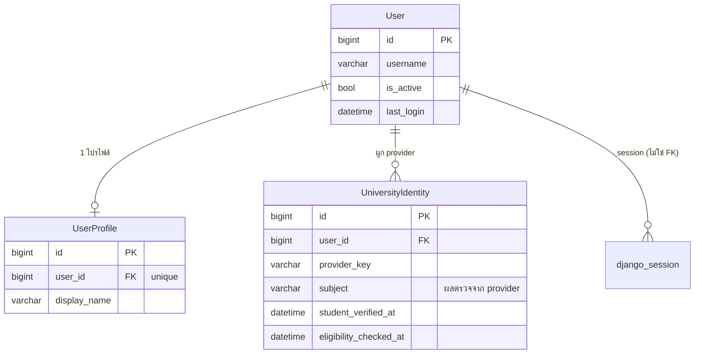
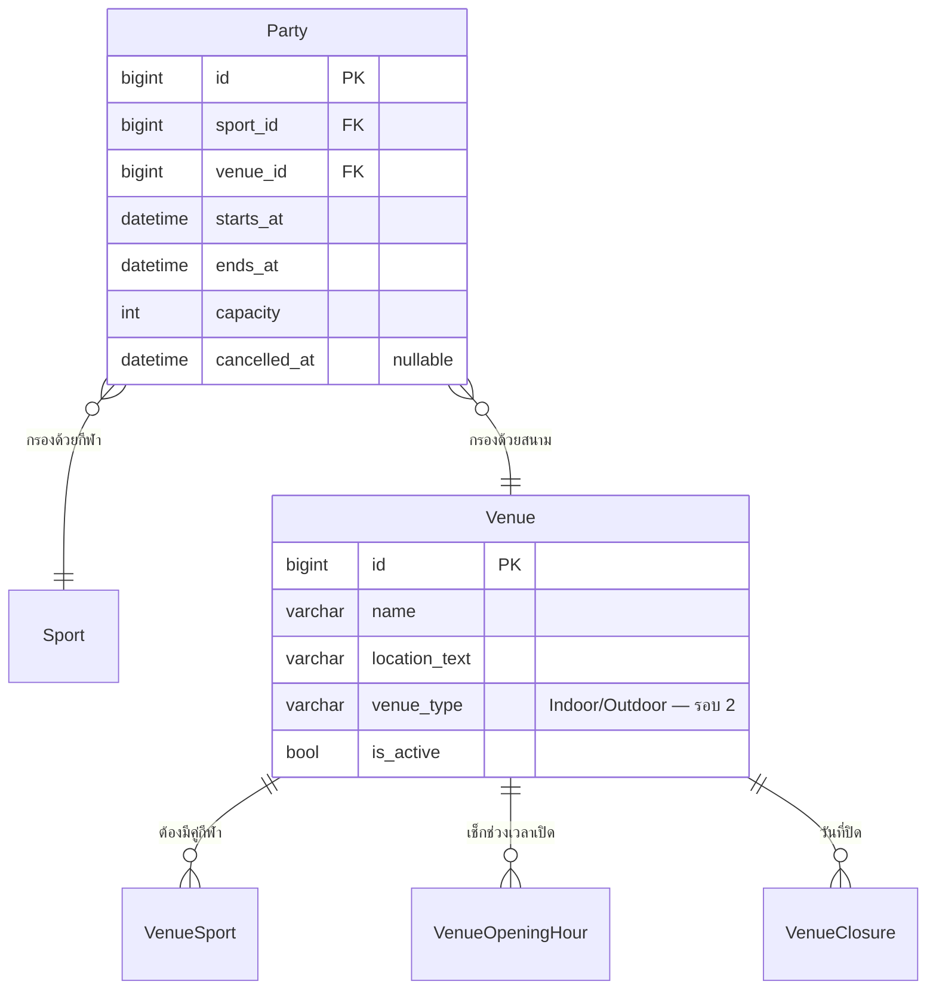
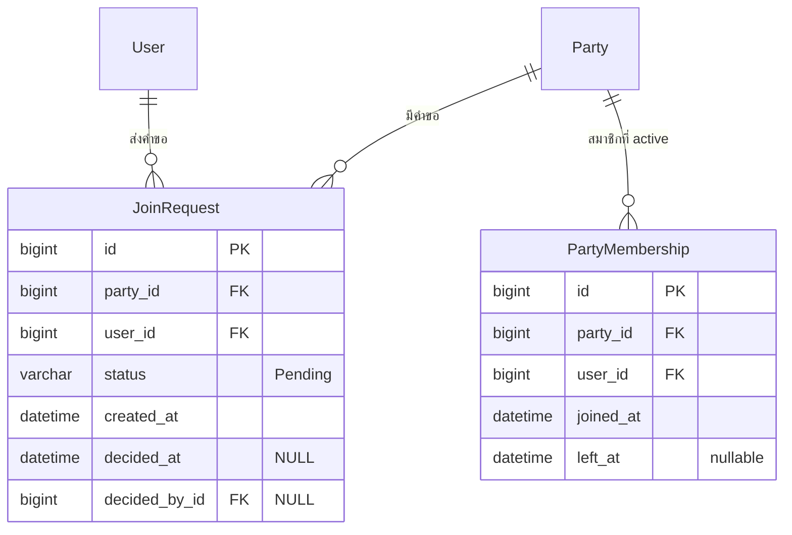
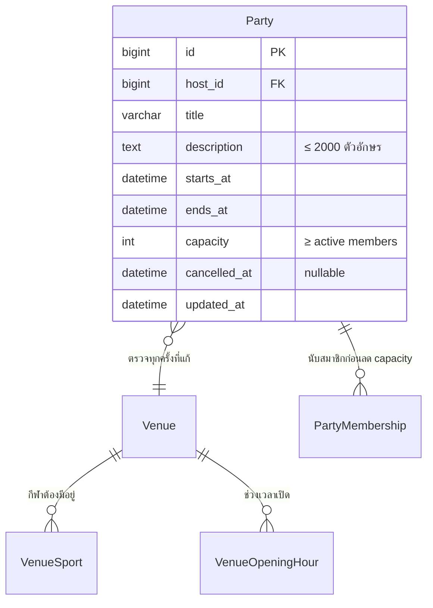
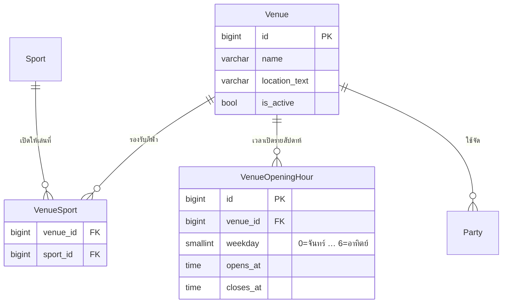
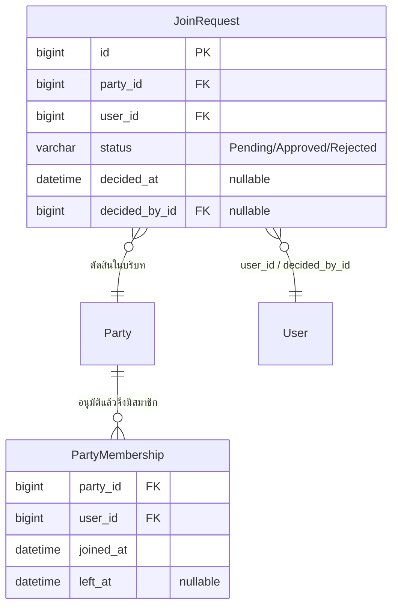
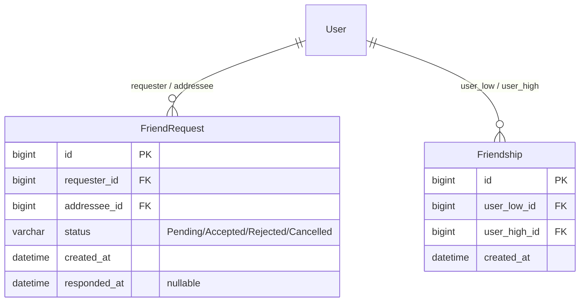
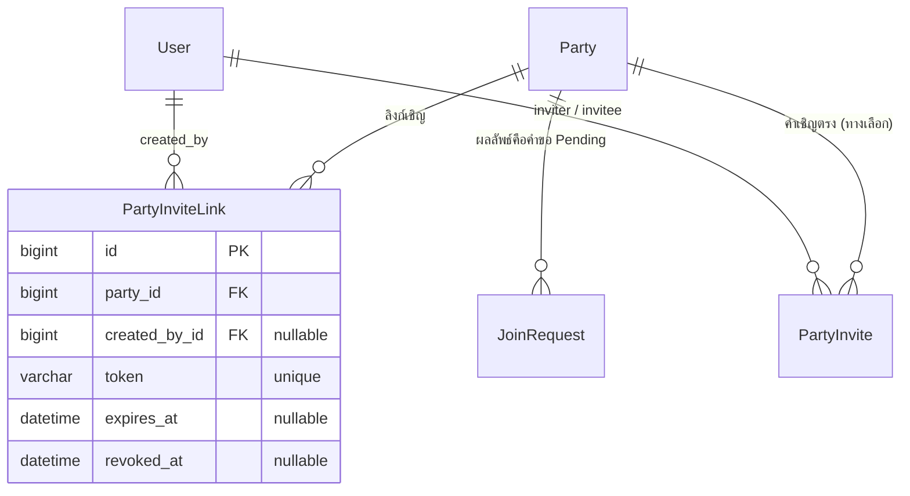
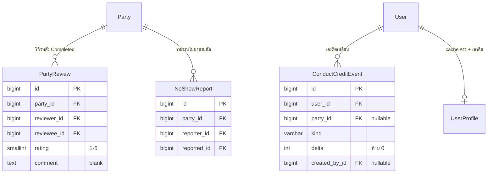

# Database แยกตาม Story + ภาพรวมตารางทั้งระบบ (Table Database Diagram)

เอกสารนี้ตอบสองคำถาม:

1. **แต่ละ Story ใช้ฐานข้อมูลอย่างไร** — แตะตารางไหน เขียนอะไรลงไป แถวหน้าตาเป็นอย่างไร
2. **ทั้งระบบมีตารางอะไรบ้าง แต่ละตารางเก็บข้อมูลอะไร** — ในรูปแบบตารางสรุป (Table Database Diagram) พร้อมตัวอย่างแถวจริง

**เอกสารนี้เป็น "view" สำหรับอ่านและรีวิว ไม่ใช่ DDL** — source of truth ยังเป็น Django ORM + migrations ใน `backend/<app>/migrations/` ตาม [database/README.md](../database/README.md) ส่วนสัญญาฉบับเต็ม (ERD ทุกโดเมน, data dictionary ทุกคอลัมน์, decision log) อยู่ที่ [BASE-02 Schema Contract](base-02-schema-contract.md) — เอกสารนี้สรุปจากสัญญาและต้องไม่ขัดกับสัญญา ถ้าขัดกันให้ยึดสัญญาแล้วแก้เอกสารนี้

**ห้ามสร้าง migration จากเอกสารนี้** — ตารางรอบ 2–5 เป็นแบบล็อกรอ Story เข้า Sprint ตามสัญญา หัวข้อ 9.2

## 1. สถานะจริงของโค้ด ณ วันที่ 14 ต.ค. 2026

| สถานะ | ตาราง | อยู่ที่ไหน |
| --- | --- | --- |
| ✅ model + migration แล้ว | `User`, `UniversityIdentity`, `UserProfile`, `UserSportInterest`, `Sport`, `Venue`, `VenueSport`, `VenueOpeningHour`, `Party`, `PartyMembership`, `JoinRequest` (+ ตารางพื้นฐาน Django) | [accounts migrations](../backend/accounts/migrations/), [venues migrations](../backend/venues/migrations/), [parties migrations](../backend/parties/migrations/) |
| 📝 แบบในเอกสารเท่านั้น | `VenueClosure`, `FriendRequest`, `Friendship`, `PartyInviteLink`, `PartyInvite` (ทางเลือก), `ChatMessage`, `ChatReadState`, `PartyReview`, `NoShowReport`, `ConductCreditEvent`, `Report`, `ModerationAction`, `Notification`, และคอลัมน์ `Venue.venue_type`, `UserProfile.rating_sum/rating_count` | สัญญา หัวข้อ 2.3–2.7 |

Migrations รอบ 1 ที่มีจริง: `venues/0001_initial`, `accounts/0002_universityidentity_userprofile`, `accounts/0003_usersportinterest`, `parties/0001_initial` และ migration follow-up ของ `parties` สำหรับ index/description.

ตารางรอบถัดไปเป็นแบบเสนอ แชทเป็น optional ยังไม่ยืนยันทำ; รอบนี้แก้เฉพาะเอกสาร Task 1 ไม่เชื่อม endpoint หรือแก้ migrations

## 2. แผนที่ Story → ตาราง (อ่านเร็ว)

| Story | ตารางที่อ่าน | ตารางที่เขียน | รอบที่สร้างตาราง |
| --- | --- | --- | --- |
| US1 Login / ยืนยันบัญชี | `User`, `UniversityIdentity`, `UserProfile` | `User` (session), `UniversityIdentity` | 1 |
| US2 ค้นหา / กรอง | `Party`, `Sport`, `Venue`, `VenueSport`, `VenueOpeningHour` | — (อ่านอย่างเดียว) | 1 + `venue_type`/`VenueClosure`/index (รอบ 2) |
| US3 ขอเข้าร่วม | `Party`, `PartyMembership`, `JoinRequest` | `JoinRequest` (Pending) | 1 |
| US4 ถอนตัว | `Party`, `PartyMembership` | `PartyMembership.left_at` | 1 |
| US5 แนะนำผู้ใช้ | `UserSportInterest`, `Sport`, `UserProfile` | — | 1 |
| US6 รายชื่อสมาชิก | `PartyMembership`, `User`, `UserProfile`, `Party` | — | 1 |
| US7 แก้ไข / ยกเลิก Party | `Party`, `Venue`, `VenueSport`, `VenueOpeningHour`, `PartyMembership` | `Party` (แก้ฟิลด์ / `cancelled_at`) | 1 |
| US8 โปรไฟล์ผู้ใช้ | `UserProfile`, `UserSportInterest`, `Party`, `PartyMembership` | — | 1 (+ `rating_sum/count` รอบ 5) |
| US9 สนามและเวลาเปิด | `Venue`, `VenueSport`, `VenueOpeningHour` | — (seed ข้อมูล) | 1 (+ `VenueClosure` รอบ 2) |
| US10 อนุมัติ / ปฏิเสธ | `JoinRequest`, `Party`, `PartyMembership` | `JoinRequest` (ตัดสิน), `PartyMembership` (เพิ่ม/เปิดใหม่) | 1 |
| US11 เพิ่มเพื่อน / Friend list | `FriendRequest`, `Friendship`, `User` | `FriendRequest`, `Friendship` | 3 |
| US12 ลบเพื่อน | `Friendship` | ลบแถว `Friendship` | 3 |
| US13 เชิญผ่านลิงก์ | `PartyInviteLink`, `Party`, `JoinRequest`, (`PartyInvite`) | `PartyInviteLink`, `JoinRequest` (ผ่าน US3) | 2 |
| US14 ให้ดาว / รีวิว / No-show | `PartyReview`, `NoShowReport`, `ConductCreditEvent`, `PartyMembership`, `Party`, `UserProfile` | `PartyReview`, `NoShowReport`, `ConductCreditEvent`, `UserProfile.rating_sum/count`, `credit_score` | 5 |
| ฟีเจอร์แชทใน Party (optional ยังไม่ยืนยันทำ) | `Party`, `PartyMembership`, `ChatMessage`, `ChatReadState` | `ChatMessage`, `ChatReadState` | 4 |
| งานรายงาน / ผู้ดูแล (ไม่มี US) | `Report`, `ModerationAction`, `User.is_staff` | `Report`, `ModerationAction`, และผลลัพธ์ (`is_active`, `cancelled_at`, `removed_at`) | 5 |
| แจ้งเตือน (ยังไม่มี Story) | `Notification` | `Notification` | รอปิด Q-10 |

ไม่มีตารางสำรองของ `User` หรือ `Party` — ทุก Story อ้างตารางชุดเดียวกันนี้ตลอดทั้งระบบ (สัญญา หัวข้อ 1.1)

## 3. Database ของแต่ละ Story

แต่ละหัวข้อมีสามส่วน: ตารางที่แตะ + ตัวอย่างแถว และกฎที่ผูกกับ Story นั้น ตัวอย่างแถวเขียนค่าจริงเพื่อให้เห็นว่า "ตารางนี้เก็บอะไรในชีวิตจริง"

### US1 — Login / ยืนยันบัญชีมหาวิทยาลัย / Logout

| ตาราง | เก็บอะไรของ Story นี้ | ตัวอย่างแถว |
| --- | --- | --- |
| `User` | บัญชีในระบบเรา ไม่ใช่บัญชีมหาวิทยาลัย — session และ `is_active` คุมสิทธิ์ทุก endpoint | `id=7, username=tee.tu, is_active=true, last_login=2026-10-12 09:41+07` |
| `UniversityIdentity` | หลักฐานว่านักศึกษายืนยันตัวตนแล้ว — เก็บเฉพาะ identifier จาก provider **ไม่เก็บรหัสผ่าน/โทเคนมหาวิทยาลัย** (D-9) | `user_id=7, provider_key=tu-sso, subject=6612345678, student_verified_at=2026-10-12 09:40+07` |
| `django_session` | session ฝั่งเซิร์ฟเวอร์ (ตารางมาตรฐานของ Django — **ไม่มีความสัมพันธ์ FK กับ `User`** ตัว user id อยู่ใน `session_data`) `POST /auth/logout` ลบแถวนี้ | `session_key=…, session_data=…, expire_date=…` |
| `UserProfile` | อ่าน `display_name` มาตอบ `GET /api/v1/me` | `user_id=7, display_name="ตี๋ ธรรมศาสตร์"` |

**กฎ:** `provider_key` มาจากค่าตั้งฝั่งเซิร์ฟเวอร์, `subject` มาจากผลตรวจ provider — ห้ามรับจาก request ตรง ๆ และห้ามผูกบัญชีด้วยชื่อ/อีเมล (Technical Plan หัวข้อ 3) login ซ้ำต้องไม่สร้างบัญชีซ้ำ → unique ของ `(provider_key, subject)` (สัญญา Q-3 ยังไม่ปิด)

### US2 — ค้นหา / กรองกิจกรรม

| ตาราง | เก็บอะไรของ Story นี้ | ตัวอย่างแถว |
| --- | --- | --- |
| `Party` | แหล่งข้อมูลหลักของการค้นหา — กรองด้วย `sport_id` + ช่วง `starts_at`/`ends_at` และตัด `cancelled_at IS NOT NULL` ออก สถานะ Open/Full คำนวณสดไม่เก็บใน DB | `id=42, sport=Badminton, venue=ยิม 2, starts_at=2026-10-16 17:00+07, capacity=4` |
| `Sport` | ตัวเลือกใน filter และแสดงชื่อกีฬา | `id=3, name=Badminton` |
| `Venue` / `VenueSport` | ยืนยันว่าสนามรองรับกีฬานั้น และกรอง `venue_type` (Indoor/Outdoor — ยืนยันแล้ว 14 ต.ค. 2026; เพิ่มรอบ 2) | `venue_id=5, sport_id=3` |
| `VenueOpeningHour` / `VenueClosure` | ใช้อธิบาย/ตรวจว่าช่วงที่นัดอยู่ในเวลาเปิด และสนามไม่ปิดเป็นช่วงวันที่ | `venue_id=5, weekday=4, opens_at=16:00, closes_at=22:00` |

**กฎ:** filter เป็นคนละแกน (`sport`, ช่วงวันเวลา, `venue_type`) → **ไม่เก็บ `venue_type` ซ้ำบน `Party`** index ที่รองรับคือ `(sport_id, starts_at)` (มีรอบ 1) และรอบ 2 เสนอเพิ่ม `(venue_id, starts_at)` กับ `(starts_at)`

### US3 — ขอเข้าร่วม Party

| ตาราง | เก็บอะไรของ Story นี้ | ตัวอย่างแถว |
| --- | --- | --- |
| `JoinRequest` | คำขอหนึ่งใบต่อ (Party, user) ตลอดไป — US3 สร้างแถวสถานะ `Pending` **ยังไม่กินที่ว่าง** | `id=91, party_id=42, user_id=12, status=Pending, created_at=2026-10-13 20:15+07, decided_at=NULL` |
| `PartyMembership` | อ่านนับ `left_at IS NULL` เพื่อเช็กว่าที่ว่างเหลือไหมและผู้ขอเป็นสมาชิกอยู่แล้วหรือยัง | `party_id=42, user_id=7 (host), joined_at=…, left_at=NULL` |
| `Party` | ล็อกแถวใน transaction เดียวกันก่อนตัดสินใจรับคำขอ | `id=42, capacity=4` |

**กฎ:** `unique (party_id, user_id)` — มี Pending เดิมอยู่แล้วได้ `409 REQUEST_EXISTS` (ไม่สร้างแถวซ้ำ); count active ต้องไม่เกิน `capacity` ภายใน transaction ที่ล็อก Party; Pending ต้องมี `decided_at`/`decided_by` เป็น NULL (CheckConstraint)

### US4 — ถอนตัวจาก Party

| ตาราง | เก็บอะไรของ Story นี้ | ตัวอย่างแถว |
| --- | --- | --- |
| `PartyMembership` | **ไม่ลบแถว** — เขียน `left_at` เป็นเวลาที่ถอน หนึ่งแถวต่อคนต่อ Party ตลอดไป (D-4) | `party_id=42, user_id=12, joined_at=2026-10-12, left_at=2026-10-15 08:30+07` |
| `Party` | ไม่มีการเปลี่ยนแปลง (ยกเว้น Host ถอนไม่ได้ — คุมที่ service) | `id=42, capacity=4` |

**กฎ:** active membership = `left_at IS NULL`; ถ้ากลับเข้าใหม่ภายหลังให้ **อัปเดตแถวเดิม `left_at=None`** ไม่สร้างแถวใหม่ (สัญญา หัวข้อ 3.3)

### US5 — แนะนำผู้ใช้งานอื่น

| ตาราง | เก็บอะไรของ Story นี้ | ตัวอย่างแถว |
| --- | --- | --- |
| `UserSportInterest` | แกนเดียวของคำแนะนำ "คนที่สนใจกีฬาเดียวกับฉัน" | `user_id=12, sport_id=3` และ `user_id=7, sport_id=3` → แนะนำ 12 ให้ 7 |
| `Sport` | แปลง `sport_id` เป็นชื่อที่แสดง | `id=3, name=Badminton` |
| `UserProfile` | แสดง `display_name` (และ `credit_score` ถ้ามีข้อมูล) ต้องกรองเฉพาะฟิลด์ที่อนุญาต | `user_id=12, display_name="เนท", credit_score=NULL` |

**กฎ:** `unique (user_id, sport_id)` กันความสนใจซ้ำ; ยังไม่มีตาราง block — การตัดคนที่ติดต่อไม่ได้ใช้การรายงาน/ผู้ดูแลแทน (สัญญา หัวข้อ 1.4)

### US6 — ดูรายชื่อสมาชิกใน Party

| ตาราง | เก็บอะไรของ Story นี้ | ตัวอย่างแถว |
| --- | --- | --- |
| `PartyMembership` | รายชื่อที่ต้องแสดง — เฉพาะแถว `left_at IS NULL` และต้องมี Host อยู่ด้วยเสมอ | `party_id=42, user_id=7, left_at=NULL` |
| `User` / `UserProfile` | ข้อมูลที่แสดงต่อคนในรายชื่อ (`display_name`) | `user_id=7 → display_name="ตี๋"` |
| `Party` | เทียบ `host_id` เพื่อติดป้าย Host — **ไม่เก็บคอลัมน์ `role`** ใน `PartyMembership` | `host_id=7` |
| `JoinRequest` | ใช้แยก "ผู้ขอที่ยัง Pending" ออกจาก "สมาชิก" — ห้ามหลุดเข้าไปในรายชื่อ | `status=Pending` ไม่แสดงในลิสต์ |

### US7 — Host แก้ไขหรือยกเลิก Party

| ตาราง | เก็บอะไรของ Story นี้ | ตัวอย่างแถว |
| --- | --- | --- |
| `Party` | ฟิลด์ที่แก้ได้ทั้งหมดอยู่ในตารางเดียว: `title`, `description`, `starts_at`, `ends_at`, `capacity` — ยกเลิก = ตั้ง `cancelled_at` (ไม่ลบแถว) | `id=42, title="แบดมินตัน 4 คน ศุกร์นี้", capacity=5, cancelled_at=NULL` |
| `VenueSport` / `VenueOpeningHour` | ต้องผ่านกฎเดิมซ้ำเมื่อแก้เวลา/สนาม — ไม่เก็บสำเนากฎบน Party | `venue_id=5, sport_id=3` |
| `PartyMembership` | นับ active เพื่อกัน `capacity` ต่ำกว่าจำนวนสมาชิก (D-5 → `409 CAPACITY_TOO_SMALL`) | นับได้ 3 → capacity ห้ามต่ำกว่า 3 |

**กฎ:** ยกเลิกแล้วห้ามแก้ (ต้องได้ `409 PARTY_CANCELLED`); `PATCH`/`cancel` ใช้ Party lock ลำดับเดียวกับ US3/US10; `CheckConstraint starts_at < ends_at` และ `capacity >= 1` เป็นด่านสุดท้ายที่ DB

### US8 — ดูโปรไฟล์ผู้ใช้

| ตาราง | เก็บอะไรของ Story นี้ | ตัวอย่างแถว |
| --- | --- | --- |
| `UserProfile` | ข้อมูลโปรไฟล์ที่แสดง — `display_name`, `credit_score` (nullable = "ยังไม่มีข้อมูล") และรอบ 5 เพิ่ม `rating_sum`/`rating_count` เป็น cache ของดาว | `user_id=7, display_name="ตี๋", credit_score=NULL, rating_sum=27, rating_count=6` |
| `UserSportInterest` + `Sport` | กีฬาที่สนใจ | `user_id=7, sport_id=3 (Badminton)` |
| `Party` / `PartyMembership` | ประวัติที่โชว์ได้ (เคยเป็น Host / เคยเข้าร่วม) | `host_id=7 → 2 ปาร์ตี้ที่จัด, membership 5 แถว` |

**กฎ:** ดาวเฉลี่ย = `rating_sum / rating_count` และส่ง `null` เมื่อ `rating_count = 0` — คนละค่ากับ `credit_score` ที่มาจาก ledger `ConductCreditEvent`; ฟิลด์เหล่านี้ client แก้ไม่ได้ (สัญญา หัวข้อ 2.6)

### US9 — ดูสนามหรือกีฬาที่เปิดให้บริการ

| ตาราง | เก็บอะไรของ Story นี้ | ตัวอย่างแถว |
| --- | --- | --- |
| `Venue` | ข้อมูลสนามที่แสดง — ชื่อ, จุดนัดพบ (`location_text`), เปิด/ปิดใช้งาน และรอบ 2 เพิ่ม `venue_type` | `id=5, name="ยิม 2 ธรรมศาสตร์ ศูนย์รังสิต", location_text="อาคารยิมเนเซียม ชั้น 1", is_active=true` |
| `VenueSport` | กีฬาที่สนามนั้นเปิดให้บริการ (ใช้กรองและกันสร้าง Party ผิดกีฬา) | `venue_id=5, sport_id=3` |
| `VenueOpeningHour` | ตารางเวลาเปิดรายวัน หนึ่งแถวต่อหนึ่งช่วงเปิด | `venue_id=5, weekday=4 (ศุกร์), opens_at=16:00, closes_at=22:00` |
| `VenueClosure` (รอบ 2) | วันปิดเป็นช่วง เช่น วันหยุดมหาวิทยาลัย/ปรับปรุงสนาม | `venue_id=5, starts_on=2026-10-23, ends_on=2026-10-25, reason="ปิดปรับปรุงพื้น"` |

**กฎ:** `CheckConstraint 0 <= weekday <= 6` และ `opens_at < closes_at` (ไม่รองรับช่วงข้ามเที่ยงคืนใน Sprint 1); `unique (venue_id, weekday, opens_at)`; ช่วงซ้อนในวันเดียวกันตรวจได้แค่ระดับแอป (validator); สนาม `is_active=False` ห้ามใช้สร้าง/แก้ Party

### US10 — อนุมัติหรือปฏิเสธคำขอเข้าร่วม

| ตาราง | เก็บอะไรของ Story นี้ | ตัวอย่างแถว |
| --- | --- | --- |
| `JoinRequest` | ผลการตัดสิน — `Approved`/`Rejected` พร้อม `decided_at` และ `decided_by_id` (เก็บไว้เป็นประวัติ) | `id=91, status=Approved, decided_at=2026-10-14 10:02+07, decided_by_id=7` |
| `PartyMembership` | เกิดเฉพาะตอน `Approved` — สร้างแถวใหม่หรือ **เปิดแถวเดิม `left_at=None`** ถ้าเคยเข้าร่วมมาก่อน | `party_id=42, user_id=12, joined_at=2026-10-14, left_at=NULL` |
| `Party` | ล็อกก่อนอนุมัติเพื่อเช็กที่ว่างแบบแข่งกันไม่ให้เกิน `capacity` | `id=42, capacity=4` |

**กฎ:** ตัดสินซ้ำ → `409 REQUEST_DECIDED`; อนุมัติตอน Party เริ่ม/เต็ม/ถูกยกเลิก → `409 PARTY_STARTED`/`PARTY_FULL`/`PARTY_CANCELLED`; CheckConstraint บังคับว่า Pending ต้องไม่มีข้อมูลผู้ตัดสิน; `decided_by_id` ใช้ `on_delete=SET_NULL` เพื่อเก็บประวัติแม้ผู้ตัดสินถูกปิดบัญชี

### US11 — เพิ่มเพื่อนและรายชื่อเพื่อน · US12 — ลบเพื่อน (รอบ 3)

| ตาราง | เก็บอะไรของ Story นี้ | ตัวอย่างแถว |
| --- | --- | --- |
| `FriendRequest` | คำขอเป็นเพื่อน (US11) — มีทิศทาง และเฉพาะ `addressee` ตอบได้ | `id=8, requester_id=7, addressee_id=12, status=Pending, responded_at=NULL` |
| `Friendship` | ความเป็นเพื่อนที่รับแล้ว — **หนึ่งแถวต่อคู่** ไม่มีสองทิศทาง (US11 แสดงเป็น Friend list, US12 ลบแถวนี้) | `user_low_id=7, user_high_id=12` (บังคับ `low < high`) |

**กฎ:** `CheckConstraint requester_id <> addressee_id`; `unique (requester_id, addressee_id)` จับคำขอซ้ำทางเดียว ส่วนทิศย้อนทางที่ยัง Pending คุมด้วย service rule; query เพื่อนสองทางด้วย `Q(user_low=me) | Q(user_high=me)`; **US12 ลบเพื่อนเป็นข้อยกเว้นเดียวที่ลบแถวจริง** (ไม่มีตารางใดอ้าง `Friendship`) — ถ้าทีมต้องการเก็บประวัติ ต้องเพิ่ม `removed_at` + partial unique (Q-8)

### US13 — เชิญเพื่อนเข้าปาร์ตี้ (รอบ 2)

| ตาราง | เก็บอะไรของ Story นี้ | ตัวอย่างแถว |
| --- | --- | --- |
| `PartyInviteLink` | ลิงก์เชิญของ Party — `token` สุ่มฝั่งเซิร์ฟเวอร์ (ไม่ใช่ `party_id`) และปิดได้ด้วย `expires_at`/`revoked_at` | `party_id=42, token="8f3c…", created_by_id=7, expires_at=2026-10-16 17:00+07, revoked_at=NULL` |
| `PartyInvite` (ทางเลือก) | คำเชิญตรงหาเพื่อนคนหนึ่ง ๆ ถ้าทีมเลือกทำ | `party_id=42, inviter_id=7, invitee_id=12, status=Pending` |
| `JoinRequest` | **เปิดลิงก์ไม่เพิ่มสมาชิกโดยตรง** — ผลลัพธ์คือแถว Pending ตาม US3 แล้วรอ US10 | `party_id=42, user_id=12, status=Pending` |

**กฎ:** ใช้ลิงก์ได้เมื่อ `revoked_at IS NULL` และ (`expires_at IS NULL` หรือยังไม่หมดอายุ) และ Party ยังรับคำขอ; คนสร้างลิงก์ต้องเป็นสมาชิกปัจจุบันของ Party; ถ้าทำ `PartyInvite` ต้องมี `unique (party_id, invitee_id)` และ `inviter_id <> invitee_id`

### US14 — ให้คะแนนและรีวิวหลังจบกิจกรรม (รอบ 5)

| ตาราง | เก็บอะไรของ Story นี้ | ตัวอย่างแถว |
| --- | --- | --- |
| `PartyReview` | ดาว 1–5 + ความคิดเห็น ต่อ (Party, ผู้รีวิว, ผู้ถูกรีวิว) | `party_id=42, reviewer_id=7, reviewee_id=12, rating=5, comment="มาตรงเวลา"` |
| `NoShowReport` | รายงานว่าไม่มาตามนัด หลังจบกิจกรรม | `party_id=42, reporter_id=7, reported_id=13` |
| `ConductCreditEvent` | ledger ของเครดิตความประพฤติ — หักอัตโนมัติจาก No-show หรือปรับโดยผู้ดูแล | `user_id=13, party_id=42, kind=NoShowDeduction, delta=-5, created_by_id=NULL (ระบบ)` |
| `UserProfile` | cache ค่าที่แสดง — `rating_sum`/`rating_count` (อัปเดตด้วย `F()` ใน transaction เดียวกับรีวิว) และ `credit_score` ที่เป็นผลของ ledger | `rating_sum=27, rating_count=6 → 4.5`; `credit_score=NULL` |

**กฎ:** รีวิว/รายงานได้เฉพาะสมาชิกของ Party นั้นและหลัง `Completed` เท่านั้น; `unique (party_id, reviewer_id, reviewee_id)` และ `unique (party_id, reporter_id, reported_id)`; `CheckConstraint 1 <= rating <= 5`, `reviewer_id <> reviewee_id`, `delta <> 0`; `unique (party_id, user_id, kind)` บังคับ "หักได้ครั้งเดียวต่อคนต่อกิจกรรม" (แถวที่ `party_id IS NULL` ไม่ถูกจำกัด); ยังไม่ตกลงสูตรเครดิต → คง `credit_score=NULL` ได้ (D-6)

### ฟีเจอร์แชทใน Party (optional ยังไม่ยืนยันทำ — เสนอรอบ 4)

| ตาราง | เก็บอะไร | ตัวอย่างแถว |
| --- | --- | --- |
| `ChatMessage` | ข้อความใน Party — soft delete ด้วย `removed_at`/`removed_by_id` เพื่อให้ผู้ดูแลตรวจย้อนหลัง | `party_id=42, author_id=12, body="ถึงสนามแล้ว", removed_at=NULL` |
| `ChatReadState` | อ่านถึงเวลาไหน (ใช้คำนวณ unread) หนึ่งแถวต่อ (Party, user) | `party_id=42, user_id=7, last_read_at=2026-10-16 18:20+07` |

### งานรายงานและผู้ดูแล (รอบ 5 — ยังไม่มี US)

| ตาราง | เก็บอะไร | ตัวอย่างแถว |
| --- | --- | --- |
| `Report` | รายงานปัญหา — อ้างเป้า **อย่างใดอย่างหนึ่ง** จากผู้ใช้ / Party / ข้อความ และมีสถานะการตรวจ | `reporter_id=12, reported_message_id=555, reason=Harassment, status=Open, handled_at=NULL` |
| `ModerationAction` | log การจัดการของผู้ดูแล **ห้ามลบ** — ผลลัพธ์ไปเขียนที่ตารางเป้าหมาย (`User.is_active`, `Party.cancelled_at`, `ChatMessage.removed_at`) | `actor_id=1, report_id=9, target_user_id=13, action=SuspendUser, reason="ยืนยันจากหลักฐาน"` |

**กฎ:** CheckConstraint ว่ามีเป้าไม่ NULL เพียงหนึ่งจากสามฟิลด์; สถานะ `Open`/`InReview` ต้องมี `handled_at IS NULL`; บทบาทผู้ดูแลใช้ `User.is_staff` + สิทธิ์ Django เดิม ยังไม่มีตาราง role (Q-12)

## 4. Table Database Diagram — ภาพรวมตารางทั้งระบบ

ตารางเดียวที่รวมทุกตาราง: แต่ละตารางเก็บข้อมูลอะไร (พร้อมตัวอย่างแถว), คีย์, รอบที่สร้าง และสถานะในโค้ด

| ตาราง | app | รอบ | เก็บข้อมูลอะไร (ตัวอย่างแถว) | PK / FK / unique หลัก | Story | สถานะในโค้ด |
| --- | --- | --- | --- | --- | --- | --- |
| `User` | accounts | 1 (BASE-01) | บัญชีในระบบเรา — `username`, `is_active`, `is_staff`, `last_login` | PK `id`; `username` unique; M2M `groups`/`user_permissions` | ทุก Story | ✅ migration แล้ว |
| `UserProfile` | accounts | 1 | โปรไฟล์สาธารณะ 1:1 กับ user — `display_name` (ห้ามว่าง), `credit_score` (nullable), รอบ 5 เพิ่ม `rating_sum`/`rating_count` | PK `id`; `user_id` OneToOne; CheckConstraint ชื่อไม่ว่าง | US5, US8, US14 | ✅ migration แล้ว |
| `UniversityIdentity` | accounts | 1 | การผูกบัญชีกับ provider มหาวิทยาลัย — `provider_key`, `subject`, `student_verified_at`; **ไม่เก็บรหัสผ่าน/โทเคน** | PK `id`; FK `user_id` (ไม่ OneToOne — ผูกหลาย provider ได้); unique `(provider_key, subject)` | US1 | ✅ migration แล้ว |
| `Sport` | venues | 1 | แคตตาล็อกกีฬา — `name` | PK `id`; `name` unique | US2, US5, US9 | ✅ migration แล้ว |
| `UserSportInterest` | accounts | 1 | user คนนี้สนใจกีฬาอะไร | FK `user_id`+`sport_id`, unique คู่ | US2, US5, US8 | ✅ migration แล้ว |
| `Venue` | venues | 1 | สนาม/สถานที่ — `name`, `location_text`, `is_active`; รอบ 2 เพิ่ม `venue_type` (Indoor/Outdoor, nullable) | PK `id` | US2, US7, US9 | ✅ migration แล้ว |
| `VenueSport` | venues | 1 | กีฬาที่สนามรองรับ (กันสร้าง Party ผิดกีฬา) | FK คู่ `venue_id`+`sport_id`, unique; index `sport_id` | US2, US7, US9 | ✅ migration แล้ว |
| `VenueOpeningHour` | venues | 1 | ช่วงเวลาเปิดรายสัปดาห์ หนึ่งแถวต่อหนึ่งช่วง — `weekday` 0–6, `opens_at`, `closes_at` | PK `id`; FK `venue_id`; unique `(venue_id, weekday, opens_at)`; check 0–6 และ `opens_at < closes_at` | US2, US7, US9 | ✅ migration แล้ว |
| `VenueClosure` | venues | 2 | วันปิดเป็นช่วง — `starts_on`, `ends_on`, `reason` | PK `id`; FK `venue_id`; unique `(venue_id, starts_on)`; check `starts_on <= ends_on` | US2, US9 | 📝 แบบในเอกสาร |
| `Party` | parties | 1 | ปาร์ตี้/นัดเล่น — `title`, `description` (≤2,000), `starts_at`/`ends_at` (UTC), `capacity` (นับรวม Host), `cancelled_at` | PK `id`; FK `host_id`/`sport_id`/`venue_id` (PROTECT); check `capacity >= 1`, `starts_at < ends_at`; index `(sport_id, starts_at)` | US2, US3, US6, US7, US8, US10, US14, แชท | ✅ migration แล้ว |
| `PartyMembership` | parties | 1 | สมาชิกของปาร์ตี้ — หนึ่งแถวต่อ (party, user) ตลอดไป, `left_at IS NULL` = ยังอยู่ | PK `id`; FK `party_id` (CASCADE)/`user_id` (PROTECT); unique `(party_id, user_id)`; index `(party_id, left_at)` | US3, US4, US6, US7, US10 | ✅ migration แล้ว |
| `JoinRequest` | parties | 1 | คำขอเข้าร่วม — `status` Pending/Approved/Rejected, `created_at`, `decided_at`, `decided_by_id` | PK `id`; FK `party_id` (CASCADE)/`user_id` (PROTECT)/`decided_by_id` (SET_NULL); unique `(party_id, user_id)`; index `(party_id, status, created_at)` | US3, US10, US13 | ✅ migration แล้ว |
| `FriendRequest` | social | 3 | คำขอเป็นเพื่อนแบบมีทิศทาง — `status`, `created_at`, `responded_at` | PK `id`; FK `requester_id`/`addressee_id` (CASCADE); unique `(requester_id, addressee_id)`; check `requester <> addressee` | US11 | 📝 แบบในเอกสาร |
| `Friendship` | social | 3 | ความเป็นเพื่อน หนึ่งแถวต่อคู่ — บังคับ `user_low_id < user_high_id` | PK `id`; FK สองฝั่ง; unique `(user_low_id, user_high_id)`; index `user_high_id` | US11, US12 | 📝 แบบในเอกสาร |
| `PartyInviteLink` | social | 2 | ลิงก์เชิญของปาร์ตี้ — `token` สุ่ม, `expires_at`, `revoked_at` | PK `id`; FK `party_id` (CASCADE)/`created_by_id` (SET_NULL); `token` unique; index `(party_id, revoked_at)` | US13 | 📝 แบบในเอกสาร |
| `PartyInvite` (ทางเลือก) | social | 2 | เชิญตรงหาผู้ใช้คนหนึ่ง — `status` Pending/Accepted/Declined/Revoked | PK `id`; FK `party_id`/`inviter_id`/`invitee_id`; unique `(party_id, invitee_id)` | US13 | 📝 แบบในเอกสาร |
| `ChatMessage` | chat | 4 | ข้อความในปาร์ตี้ — `body` (≤2,000), `created_at`, soft delete `removed_at`/`removed_by_id` | PK `id`; FK `party_id` (CASCADE)/`author_id` (PROTECT)/`removed_by_id` (SET_NULL); index `(party_id, created_at)` | แชท | 📝 แบบในเอกสาร |
| `ChatReadState` | chat | 4 | ใครอ่านข้อความถึงเวลาไหน (คำนวณ unread) | PK `id`; FK `party_id`/`user_id` (CASCADE); unique `(party_id, user_id)` | แชท | 📝 แบบในเอกสาร |
| `PartyReview` | conduct | 5 | ดาว 1–5 + คอมเมนต์ ต่อ (Party, ผู้รีวิว, ผู้ถูกรีวิว) | PK `id`; FK `party_id` (CASCADE)/`reviewer_id`/`reviewee_id` (PROTECT); unique `(party_id, reviewer_id, reviewee_id)`; check `1 <= rating <= 5` | US14 | 📝 แบบในเอกสาร |
| `NoShowReport` | conduct | 5 | รายงานว่าไม่มาตามนัดหลังจบกิจกรรม | PK `id`; FK ทั้งสาม (CASCADE/PROTECT); unique `(party_id, reporter_id, reported_id)` | US14 | 📝 แบบในเอกสาร |
| `ConductCreditEvent` | conduct | 5 | ledger การเปลี่ยนเครดิตความประพฤติ — `kind`, `delta` (ห้าม 0), `note`, `created_by_id` | PK `id`; FK `user_id` (PROTECT)/`party_id` (SET_NULL)/`created_by_id` (SET_NULL); unique `(party_id, user_id, kind)` | US14 | 📝 แบบในเอกสาร |
| `Report` | moderation | 5 | รายงานปัญหา — อ้างเป้าเดียว (user / Party / ข้อความ), `reason`, `status`, `handled_by_id`, `handled_at` | PK `id`; FK เป้าทั้งสามเป็น nullable (CASCADE / SET_NULL); check มีเป้าเดียว; index `(status, created_at)` | ผู้ดูแล | 📝 แบบในเอกสาร |
| `ModerationAction` | moderation | 5 | log การจัดการ ห้ามลบ — `action`, `reason`, เป้าหมาย, อ้าง `Report` | PK `id`; FK `actor_id`/`report_id`/เป้า เป็น nullable + SET_NULL | ผู้ดูแล | 📝 แบบในเอกสาร |
| `Notification` | notifications | รอ Q-10 | แจ้งเตือนผู้ใช้ — `kind`, `title`, `body`, `link` (path ภายในเท่านั้น), `read_at` | PK `id`; FK `user_id` (CASCADE); index `(user_id, read_at, created_at)` | ยังไม่มี Story | 📝 แบบในเอกสาร |

**ภาพความสัมพันธ์ทั้งระบบ (แผนที่ระดับโดเมน):** ดู [สัญญา schema หัวข้อ 2.1](base-02-schema-contract.md#21-ภาพรวมทั้งระบบ-ทุกโดเมน) — เอกสารนี้ไม่คัดลอก ERD ทั้งระบบมาไว้ซ้ำ เพื่อไม่ให้มีสองฉบับที่หลุด sync กัน

### Party เก็บสถานะไหม?

ไม่เก็บ — DB เก็บแค่ `cancelled_at` และเวลานัด ส่วน Open/Full/InProgress/Completed **คำนวณจากข้อมูลจริง** ทุกครั้ง (service `get_party_state` ที่จะเพิ่มใน US3/US7) เพื่อไม่ให้สถานะค้างไม่ตรงกับความจริง

| สถานะที่ API ส่ง | เงื่อนไขจาก DB |
| --- | --- |
| `Cancelled` | `Party.cancelled_at IS NOT NULL` |
| `Completed` | `now >= ends_at` |
| `InProgress` | `starts_at <= now < ends_at` |
| `Full` | จำนวน `PartyMembership` ที่ `left_at IS NULL` ≥ `capacity` |
| `Open` | นอกเหนือจากข้างต้น |

## 5. กลุ่มข้อมูลของทั้งระบบ (6 แกน)

| แกน | ตาราง | ตอบคำถามอะไร |
| --- | --- | --- |
| ตัวตนและการยืนยัน | `User`, `UniversityIdentity`, `UserProfile` | ใครเป็นใคร ยืนยันนักศึกษาแล้วหรือยัง และโปรไฟล์คืออะไร |
| แคตตาล็อกกีฬา | `Sport`, `UserSportInterest` | มีกีฬาอะไร และใครสนใจอะไร (ฐานของ US2/US5) |
| สถานที่ | `Venue`, `VenueSport`, `VenueOpeningHour`, `VenueClosure` | นัดได้ที่ไหน เมื่อไร และปิดวันไหน |
| กิจกรรมและสมาชิก | `Party`, `PartyMembership`, `JoinRequest` | นัดอะไร ที่ไหน เมื่อไร ใครอยู่ ใครขอเข้า |
| สังคมและแชท | `FriendRequest`, `Friendship`, `PartyInviteLink`, `PartyInvite`, `ChatMessage`, `ChatReadState` | ใครเป็นเพื่อนกัน เชิญกันอย่างไร และคุยกันว่าอะไร |
| ความประพฤติและความปลอดภัย | `PartyReview`, `NoShowReport`, `ConductCreditEvent`, `Report`, `ModerationAction`, `Notification` | เชื่อถือได้แค่ไหน เกิดอะไรผิด และใครจัดการ |

## 6. ตารางที่ยังไม่มี Story และที่ไม่อยู่ในแผน

| ตาราง/เรื่อง | สถานะ |
| --- | --- |
| `Notification` | ออกแบบไว้ล่วงหน้า แต่ยังไม่มี Story รองรับ — รอปิด Q-10 ถ้าไม่ทำ ให้ตัดออกจาก ERD ก่อนรีวิวรอบสุดท้าย |
| ตารางจองสนาม / กันชนเวลาสนาม | **ไม่อยู่ในแผน** — ไม่มี requirement ว่า Party ต้องจองหรือกันสิทธิ์สนาม (D-10) |
| ไฟล์แนบ/รูปในแชท | **ไม่อยู่ในแผน** — README ระบุแชทข้อความเท่านั้น |
| พิกัด GPS / แผนที่ | **ไม่อยู่ในแผน** — ใช้ `Venue.location_text` เป็นจุดนัดพบขั้นต่ำ |
| ระบบบล็อกผู้ใช้ (block) | **ไม่อยู่ในแผน** — ใช้รายงาน + ผู้ดูแลแทน |
| ตาราง role ผู้ดูแล | **ไม่มี** — ใช้ `User.is_staff` + สิทธิ์ Django (Q-12) |
| ตารางเก็บรหัสผ่าน/โทเคนมหาวิทยาลัย | **ไม่มี** — ใช้ session ของ Django (D-9) |

## 7. ลำดับ migration และนโยบาย FK (สรุปจากสัญญา หัวข้อ 7–8)

ไม่มี FK circular ใน schema รอบนี้: `venues` สร้าง `Sport`/`Venue` ก่อน, `accounts` เพิ่ม identity/profile และ interest ที่อ้าง `venues.Sport`, จากนั้น `parties` อ้าง `venues` และ user ที่มีอยู่แล้ว

| ลำดับ | ไฟล์ migration | สร้างอะไร | dependency |
| --- | --- | --- | --- |
| — | `accounts/0001_initial` | `User` | ✅ ทำแล้ว (BASE-01) |
| 1 | `venues/0001_initial.py` | `Sport`, `Venue`, `VenueSport`, `VenueOpeningHour` | — |
| 2 | `accounts/0002_universityidentity_userprofile.py` | `UniversityIdentity`, `UserProfile` | `accounts.0001_initial` |
| 3 | `accounts/0003_usersportinterest.py` | `UserSportInterest` | `accounts.0002` + `venues.0001` |
| 4 | `parties/0001_initial.py` | `Party`, `PartyMembership`, `JoinRequest` และ constraint/index หลัก | `venues.0001` + `accounts.0001` |
| 5 | `parties/0002_*`, `parties/0003_*` | index active membership และ validation `description` | `parties.0001` |
| รอบถัดไป | `venues/0002_venueclosure.py`, `social/0001_invite.py` | `Venue.venue_type`, `VenueClosure`, `PartyInviteLink` | เมื่อ US2/US13 เข้า Sprint |
| รอบถัดไป | `social/0002_friend.py` | `FriendRequest`, `Friendship` | `accounts.0001_initial` |
| รอบถัดไป | `chat/0001_initial.py` | `ChatMessage`, `ChatReadState` | `parties.0001` |
| รอบถัดไป | `accounts/0004_profile_rating.py`, `conduct/0001_initial.py` | rating cache และข้อมูล US14 | ตาม migration รอบ 1 ที่เกี่ยวข้อง |

นโยบาย FK ที่ทุก migration ใช้: แถวส่วนตัวของ user และข้อมูลในบริบทของ Party → `CASCADE`; ข้อมูลที่เป็นประวัติ/ความประพฤติและ entity ที่ห้ามลบ → `PROTECT`; ผู้ที่อาจปิดบัญชีภายหลัง (ผู้ตัดสินคำขอ, ผู้ดูแล, ระบบ) → `SET_NULL` และห้าม hard delete `User`/`Sport`/`Venue`/`Party` ที่ถูกอ้างอิง — ใช้ `is_active`/`cancelled_at` แทน.

## 8. เอกสารที่เกี่ยวข้อง

- [BASE-02 Schema Contract](base-02-schema-contract.md) — ERD ทุกโดเมน, data dictionary ทุกคอลัมน์, กฎที่ service ต้องรักษา, migration order, decision log
- [Sprint 1 Technical Plan](sprint-1-technical-plan.md) — ตาราง DB ขั้นต่ำ, API inventory, error contract
- [User Stories](user-stories.md) — AC ของ US1–US14
- [Development guide](development.md) — วิธีรัน migrations และ environment
- [database/README.md](../database/README.md) — นโยบาย schema/migrations ของทีม

### ข้อสรุป Task 1 — 14 ต.ค. 2026

โกลยืนยันให้ผู้ถูกปฏิเสธหรือถอนตัวขอเข้าร่วมใหม่ได้ ใช้ JoinRequest แถวเดิมกลับเป็น Pending ล้างผลตัดสินเดิมและรอ Host อนุมัติใหม่; membership กลับมา active เมื่ออนุมัติเท่านั้น เก็บข้อมูลรอบล่าสุด ไม่เก็บประวัติทุกรอบ ดู Schema Contract หัวข้อ 4.1.1 แชทเป็น optional ยังไม่ยืนยันทำ และประเภทสนามคือ Indoor/Outdoor
